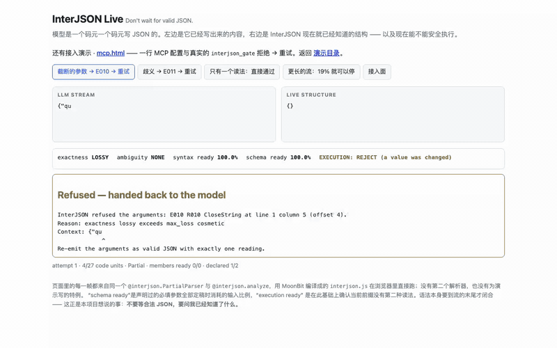
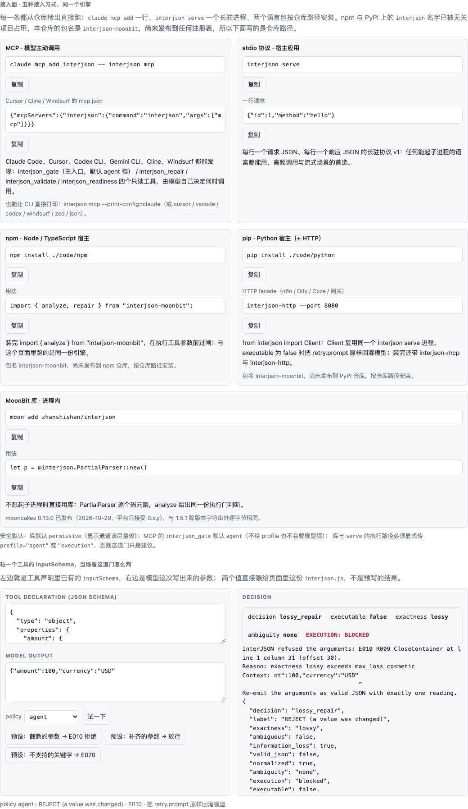

# InterJSON — LLM 输出的执行门 · 本地 MCP

**版本**：1.4.0

[](https://github.com/wenhuang2333/Moonbit-haker/actions/workflows/ci.yml)
[](code/LICENSE)
[](https://wenhuang2333.github.io/Moonbit-haker/live.html)

**InterJSON 是 LLM 输出的执行门：模型给出的工具参数与结构化结果，先过它，再决定能不能执行。**

**它怎么跑。** 一个本地原生二进制（引擎是纯 MoonBit），`interjson mcp` 以 stdio 上的 MCP
server 运行：不联网、不需要 API key、不监听端口，被检查的文本不离开本机。二进制以
`interjson-mcp` 为名启动时等价于 `interjson mcp`。

**一行接入。** Claude Code：

```bash
claude mcp add interjson -- interjson mcp
```

其他客户端用 `interjson mcp --print-config=cursor|vscode|codex|windsurf|zed|json` 打印现成配置。

**它返回什么。** `interjson_gate` 返回 `executable` / `decision` / `exactness` / `value` /
`retry.prompt`：

| 字段 | 含义 |
| --- | --- |
| `executable` | 这份结果能不能直接执行。 |
| `decision` | `safe` / `cosmetic_repair` / `lossy_repair` / `ambiguous` / `invalid`。 |
| `exactness` | `exact` / `cosmetic` / `lossy`：修复有没有改动信息。 |
| `value` | 解析后的 JSON 值；即使能解析，也不代表能执行——执行与否只看 `executable` / `decision`。 |
| `retry.prompt` | 不能执行时，可直接回灌模型的重试提示。 |

`executable == false` 时不要执行：把 `retry.prompt` 原样发回模型，让它重发参数。

**为什么不是「又一个 JSON 修复库」。** 修复库交付的是「更干净的文本」，InterJSON 交付的是
**判定**：这段输出能不能执行、不能执行时模型该改什么。修复得对只是入口——
`{"a":"b","a":"c"}` 是合法 JSON 却没有唯一含义；`{"path":"/tmp/x` 补上右引号就能解析，
但补出来的内容不是模型说的。执行档（`agent` / `execution`）下两者都被拒绝，而不是先执行再后悔。
`interjson mcp` 让 agent 直接调用这道门；`interjson serve` / npm / pip 让宿主在执行工具参数前过同一道门。

MCP 暴露四个工具：`interjson_gate`（首选；不传 `profile` 时默认 `agent`，有损或有第二种读法的
修复会被拒绝）、`interjson_repair`（返回修复文本）、`interjson_validate`（只校验、不修复）、
`interjson_readiness`（每个声明字段何时定稿）。四个工具都是只读的（`readOnlyHint`），结果同时
走文本通道与 `structuredContent`；协议版本 `2025-06-18`，同时接受 `2024-11-05`。

**MCP 接入 · 一段真实会话**：Claude Code 2.1.301（Anthropic 的官方客户端）连上本仓库的 MCP
server，把被 `max_tokens` 截断的工具参数交给执行门，收到 **E010 拒绝**与可直接回灌模型的
`retry.prompt`；模型改对后再调用一次即**放行**。逐字节的原始事件流附在
[`mcp-claude-session.txt`](static/demo/mcp-claude-session.txt)
（真实会话 id、时间戳、工具入参与返回都在里面，可逐条核对；录制于本次更名之前，
事件流里的服务名与工具名保留当时的名称，内容未做改写）。派生动画与封面已按发布
清理规则删除，文字证据保留。

> **关于模型（如实说明）**：客户端与 MCP 协议是 Anthropic 的真货，但本机的
> `ANTHROPIC_BASE_URL` 指向第三方网关，所以**驱动这段会话的权重不是 Anthropic 的**
> （会话记录里写着实际模型名与 `modelUsage`）。把那个 `env` 换成 Anthropic 端点、
> 重跑 `code/tests/media/record_claude_mcp.py`，得到的就是 Claude 模型的会话。**引擎那一侧
> 百分之百是真的**——E010 与放行都是本仓库的 `interjson` 自己判的。

交互版 [mcp.html](https://wenhuang2333.github.io/Moonbit-haker/mcp.html)。

[English](#english) · [详细文档](#文档索引) · [演示页](#演示页) · [测试证据](#质量与证据)

**一键演示 · Try it live**：<https://wenhuang2333.github.io/Moonbit-haker/live.html>
（[演示目录](https://wenhuang2333.github.io/Moonbit-haker/) · [本地打开](#演示页) · [80 秒录屏](static/demo/demo.mp4)）



```
{'name': 'MoonBit', 'tags': ['json', 'repair',], 'ok': true,}
                ↓  interjson
{"name":"MoonBit","tags":["json","repair"],"ok":true}
```

## 为什么需要它

LLM 的结构化输出经常不是合法 JSON：外面裹着 ``` 围栏、前面带一句「好的，这是你要的 JSON」、
用单引号、夹着 `//` 注释、尾逗号、`NaN`/`undefined`、被 `max_tokens` 截断在半个字符串中间。
严格解析器遇到这些直接抛错，而流式场景下应用只拿到前缀。TypeScript 与 Python 有成熟方案。

MoonBit 生态里已有 [`btlqql/moon_json_repair`](https://mooncakes.io/docs/btlqql/moon_json_repair@0.1.1)（保守修复，
明确声明 *"This implementation buffers input; it is not an unbounded streaming parser"*）。
InterJSON 与它的分工不同，一句话概括：

> **moon_json_repair 修的是已经写完的坏 JSON；InterJSON 修的是正在生成中的坏 JSON ——
> 模型每吐一个 token，应用就能多读到一点。**

差异清单见 [与 moon_json_repair 的定位差异](#与-moon_json_repair-的定位差异)。

三条不变量贯穿实现，并由属性测试强制：

1. **输出合法** —— 修复后的文本一定可以被标准 JSON 解析器接受；
2. **幂等** —— 再修一次不再产生任何改动；
3. **分块不变** —— 一次性喂入与任意切分逐块喂入，文本、修复记录、错误完全一致。

还有一条是 0.3.0 加的，回答「修完能不能直接用」：

> **每个结果都带精确度标签**：`Exact`（没修）、`Cosmetic`（只改记法）、`Lossy`（发明或丢弃了信息）。
> 需要直接执行参数时设 `max_loss: Cosmetic`，一旦有损就在第一条记录处抛错，而不是先执行再后悔。

0.6.0 把这件事说清楚，因为它是这个库存在的理由：

> ### InterJSON 不把「语法合法」当成「可以执行」。
>
> `{"a":"b","a":"c"}` 是合法 JSON —— RFC 8259 允许重复键，把「谁赢」留给消费者 ——
> 但它没有唯一含义：`KeepLast` 和 `KeepFirst` 得到不同的值。InterJSON 因此把它归一化（R018）、
> 标记 `exactness = Lossy`、并把 `ambiguity` 报成 **语义歧义**；在执行档（`for_execution` / `for_agent`）
> 下直接拒绝执行。它不会因为「能解析」就放行。
>
> 这两个问题在库里由两个不同的数回答，`interjson explain --json` 同时给出：
>
> | 字段 | 回答的问题 |
> | --- | --- |
> | `valid_json` | 这段文本本身是不是合法 JSON？ |
> | `normalized` | InterJSON 有没有改写它？ |
> | `ambiguity` | `none` / `syntactic`（记法有两种读法，值相同）/ `semantic`（两个值被合成一个，消费者可以不同意） |
> | `execution` | `allowed` / `blocked` |
>
> ```
> $ printf '%s' '{"a":"b","a":"c"}' | interjson explain --json --policy execution
> {"decision":"lossy_repair", ..., "valid_json":true, "normalized":true,
>  "ambiguity":"semantic", "execution":"blocked", ...}
> ```
>
> `valid_json:true` 与 `execution:"blocked"` 并列，就是这条原则的全文。

## 60 秒接入（MCP）

**① 拿到二进制。** 从 [Release `v1.4.0`](https://github.com/wenhuang2333/Moonbit-haker/releases/tag/v1.4.0)
下载对应平台的 `interjson` CLI，或从源码构建：

```bash
cd code
moon build cmd/interjson --target native --release
# 产物：code/_build/native/release/build/cmd/interjson/interjson.exe
```

也可以走语言包（发布前按仓库路径安装；包名是 `interjson-moonbit`）：

```bash
pip install ./code/python    # 提供 interjson-mcp 与 interjson-http
npm install -g ./code/npm    # 提供 interjson-mcp
```

`interjson-mcp` 只是找到并启动同一个原生二进制：pip / npm 的入口都需要 `interjson`
在 `PATH` 上，或用 `INTERJSON_BIN` 指向它。两个包都不打包原生二进制
（npm 包里的 `interjson.js` 是同一引擎的 JS 构建，供进程内调用，不能当 MCP server 用）。

**② 一行接进 Claude Code：**

```bash
claude mcp add interjson -- interjson mcp
```

Cursor / Cline / Windsurf 用同一份 JSON：

```json
{"mcpServers":{"interjson":{"command":"interjson","args":["mcp"]}}}
```

其余客户端不用手写：

```bash
interjson mcp --print-config=claude    # claude mcp add interjson -- interjson mcp
interjson mcp --print-config=cursor    # {"mcpServers":{...}}
interjson mcp --print-config=vscode    # {"servers":{...}}
interjson mcp --print-config=codex     # [mcp_servers.interjson] TOML
interjson mcp --print-config=windsurf  # {"mcpServers":{...}}
interjson mcp --print-config=zed       # {"context_servers":{...}}
interjson mcp --print-config=json      # 默认
```

**③ 看一次判定。** 一段被 `max_tokens` 截断的工具参数：

```text
{"amount":100,"currency":"USD"      ← 缺右花括号
```

`tools/call` 调用 `interjson_gate`，返回（节选；完整对象还含 `repairs`，`value` 在 `agent` 档下被拒时为 `null`）：

```json
{"decision":"lossy_repair","executable":false,"exactness":"lossy","ambiguity":"none",
 "retry":{"code":"E010",
          "prompt":"InterJSON refused the arguments: E010 R009 CloseContainer at line 1 column 31 (offset 30).\nReason: exactness lossy exceeds max_loss cosmetic\n…"}}
```

`executable == false`，不要执行；把 `retry.prompt` 原样回灌模型。模型重发
`{"amount":100,"currency":"USD"}` 后再过一次门，`executable` 为 `true`。

部署细节、安全边界与逐客户端配置见 [code/docs/MCP.md](code/docs/MCP.md)。

## 快速开始（库与命令行）

```bash
# 1. 安装工具链（若尚未安装）
curl -fsSL https://cli.moonbitlang.com/install/unix.sh | bash
export PATH="$HOME/.moon/bin:$PATH"

# 2. 构建与测试（HTTPS 可直接匿名克隆；SSH 用 git@github.com:wenhuang2333/Moonbit-haker.git）
git clone https://github.com/wenhuang2333/Moonbit-haker.git
cd Moonbit-haker/code
moon check --deny-warn   # 0 warning
moon test                # 217 个测试全部通过
```

```moonbit
// 3. 一次性修复
let r = @interjson.repair("{'a':1,}")
// r.text    == {"a":1}
// r.repairs == [R003 1:2 quote normalized to double quote,
//               R005 1:7 extra comma removed]

// 4. 流式部分解析：边生成边用
let p = @interjson.PartialParser::new()
p.feed("{\"name\":\"Mo")
p.snapshot()          // {"name":"Mo"} | Partial | name
p.feed("onBit\",\"tags\":[\"json\"]}")
p.finish()            // Complete, {"name":"MoonBit","tags":["json"]}

// 5. 执行安全闸：只接受没有信息损失的修复
let safe = @interjson.Options::for_execution()   // max_loss: Cosmetic
let q = @interjson.PartialParser::new(options=safe)
q.feed("{\"path\":\"/tmp/x\"")   // 截断在字符串中间
q.finish()            // 抛 E010：CloseString 会补内容，超出 Cosmetic

// 6. 大模型工具流：直接吃 provider 的事件
let s = @llm.ToolStream::new(@llm.Anthropic)
for v in s.push_event("{\"type\":\"content_block_delta\",...}") {
  // v.snapshot.value 是当前参数，v.exactness 是当前标签，v.done 表示调用已结束
}
```

## 接入面

四个接入面，按「谁来决定使用」区分。MCP 是模型自己能调用的面（也是本产品的默认入口）；
`serve` 与语言包是宿主侧的面：宿主在执行工具参数前过同一道门。逐工具配方见
[code/docs/INTEGRATIONS.md](code/docs/INTEGRATIONS.md)，部署细节见
[code/docs/MCP.md](code/docs/MCP.md)。

| 接入面 | 命令 / 包 | 适合 | 谁调用 |
| --- | --- | --- | --- |
| **MCP** | `interjson mcp`（别名 `interjson-mcp`） | Claude Code、Cursor、Codex CLI、Gemini CLI、Cline、Windsurf、Zed | 模型主动调用 |
| **长驻协议** | `interjson serve` | 任何能起子进程的语言；高频/流式 | 宿主应用 |
| **语言包** | `npm install ./code/npm` / `pip install ./code/python` | Node / Python 宿主 | 宿主应用 |
| **HTTP** | `interjson-http --port 8080` | n8n、Dify、Coze、网关 | 宿主应用 |

> npm / PyPI 上的发行名是 **`interjson-moonbit`**（后缀标识 MoonBit 引擎），
> 在正式发布前按仓库路径安装（上表两条命令），Python 的 import 名仍是 `interjson`。

MCP 的四个工具：

| 工具 | 用途 |
| --- | --- |
| `interjson_gate` | 执行门（首选）：`executable` / `decision` / `exactness` / `ambiguity` / `value` / `retry.prompt`；不传 `profile` 时默认 `agent` |
| `interjson_repair` | 修复并返回文本与修复记录 |
| `interjson_validate` | 只校验，不修复 |
| `interjson_readiness` | 每个声明字段在流的哪个位置定稿 |

`interjson_gate` 的 `executable == false` 时，把 `retry.prompt` 原样回灌模型即可。
四个工具都是只读的（`readOnlyHint`），结果同时走文本通道与 `structuredContent`；
协议版本 `2025-06-18`，同时接受 `2024-11-05`。

宿主侧的推荐写法（Python）：

```python
from interjson import Client

with Client() as jm:
    plan = jm.analyze(model_text, profile="agent", schema_json=tool["inputSchema"])
    if not plan["executable"]:
        return retry_with(plan["retry"]["prompt"])
    execute(json.loads(plan["text"]))
```

`schema_json` 直接吃工具已有的 JSON Schema 子集（`type`/`properties`/`required`/
`items`/`enum`/`const`/`minimum`/`maximum`/`exclusiveMinimum`/`exclusiveMaximum`/
`minLength`/`maxLength`/`pattern`），不需要把声明翻译成 InterJSON 的 DSL；
不支持的键（`$ref`、`oneOf` 等）会报 `E070`，而不是静默忽略。

**安全默认**：库默认 `permissive`（显示通道该尽量修）；任何**执行**路径必须显式传
`profile="agent"` 或 `"execution"`，否则这道门只是建议。协议、MCP、npm、pip、HTTP
的文档都按这个默认写。

## 命令行

```bash
moon build cmd/interjson --target native --release
J=./_build/native/release/build/cmd/interjson/interjson.exe

$J broken.json > fixed.json          # 修复并输出
$J --report broken.json              # 修复记录写到 stderr
R003 1:2 quote normalized to double quote
R005 1:46 extra comma removed

$J --check broken.json ; echo $?     # 1：需要修复
$J --strict broken.json ; echo $?    # 5：严格模式，第一条记录即报错
interjson: E010 StrictViolation at 1:2 (offset 1): R003 NormalizeQuote: quote normalized to double quote
  {'name': 'MoonBit', 'tags': ['json', 'repair',], 'ok': true,}
   ^

$J --indent 2 broken.json            # 缩进输出

$J --max-loss cosmetic broken.json   # 超出精确度上限时退出码 5，并指出是哪条修复
$J --explain broken.json             # 逐条打印级别、位置与插入符片段
$J --batch < cases.jsonl             # 逐行 {"id","input"} → 逐行结果 JSON
$J llm --provider anthropic --follow events.jsonl   # 工具调用流：每次增量一行

# 0.5.0：一次调用拿到「能不能执行」+ 回灌模型的话
$J explain --policy execution --schema '{!query:string,!limit:integer}' tool_call.json
InterJSON Analysis
────────────────────────────────
Input:
  {"query":"MoonBit","limit":10,"note":1,}

Repair:
  R005 RemoveExtraComma (remove at 1:39)

Risk:
  exactness = cosmetic
  ambiguity = none
  information_loss = false
  schema = 2/2

Decision:
  SAFE TO EXECUTE (notation normalised)

Repaired:
  {"query":"MoonBit","limit":10,"note":1}

# 上面是 stdout；就绪数字在 stderr 上（--json 换成机器可读的完整计划）
interjson: syntax-ready 975/1000 schema-ready 750/1000 declared 2/2 ok=true step 1
$ echo $?
0

$ printf '{"words":["colour" "color"]}' | $J explain --policy execution ; echo $?
Repair:
  R006 InsertComma (insert at 1:20) [ambiguous: adjacent_strings]

Decision:
  BLOCKED (two readings)

Suggested retry:
  InterJSON refused the arguments: E011 R006 InsertComma at line 1 column 20 (offset 19).
  Reason: two adjacent strings may be two elements or one concatenated string
  Ambiguity: adjacent_strings
  Context: {"words":["colour" "color"]}
                              ^
  Re-emit the arguments as valid JSON with exactly one reading.
5
```

| 退出码 | 含义 |
| --- | --- |
| 0 | 成功（可能有修复） |
| 1 | `--check` 发现需要修复 |
| 2 | 用法错误（未知选项、非法取值、E050；骨架声明写错 E070） |
| 3 | 输入无效（E001/E002/E040/E060，或文件不可读） |
| 4 | 资源限制（E020/E021/E022） |
| 5 | 拒绝执行（E010 超预算、E011 歧义、E070 骨架不符） |
| 70 | 内部错误（E030） |

## 功能一览

| 能力 | 说明 |
| --- | --- |
| **安全档位** | `SafetyPolicy` 五档（`permissive`/`interactive`/`execution`/`agent`/`strict`）；`with_policy` 只换安全字段、保留协议字段，`of_options` 可反查 |
| **一次调用拿到计划** | `analyze(input, options?, readiness?, schema?)` → `RepairPlan`：决策、修复操作（含动作与置信类别）、重试提示、JSON 通道；**永不抛错** |
| **执行决策** | `ExecutionDecision` 五态（`safe`/`cosmetic_repair`/`lossy_repair`/`ambiguous`/`invalid`），风险可排序 |
| **骨架感知就绪** | `Schema` 文本 DSL + `semantic_readiness`：同一条流上给出「语法就绪」与「骨架就绪」两个分数，以及缺失/类型不符清单 |
| **JSON Schema 桥** | `Schema::of_json_schema` / `parse_json_schema`：直接吃工具声明的 `type`/`properties`/`required`/`items`/`enum`/`const`/数值与长度约束/字符类 `pattern`；不支持的键报 `E070` |
| **长驻协议** | `interjson serve`：版本化 JSONL，`repair`/`analyze`/`validate`/`readiness`/`watch.*`/`llm.*`；stdout 只走协议，逐行 flush |
| **MCP server** | `interjson mcp`（别名 `interjson-mcp`）：`interjson_gate`（执行门，默认 `agent` 档）/ `interjson_repair` / `interjson_validate` / `interjson_readiness`，stdio JSON-RPC 2.0，只读工具 + `structuredContent`，协议 `2025-06-18`（兼容 `2024-11-05`）；`--print-config` 打印客户端配置 |
| **语言包** | npm（ESM/CJS/类型）与 pip（薄客户端 + HTTP facade），包装同一份引擎 |
| 一次性修复 | `repair` 返回修复文本、`Json` 值与逐条修复记录（码、位置、级别、消息） |
| 流式部分解析 | `PartialParser::feed` / `feed_bytes` / `snapshot` / `finish`，快照给出值、完整性状态与未闭合路径 |
| 22 条修复规则 | R001–R022：围栏、注释、引号、裸词、逗号、冒号、缺值补 null、容器/字符串闭合、数字、字面量、转义、括号错配、意外内容、多余闭合符、重复键、相邻字符串拼接、省略号、前导说明、字面量大小写 |
| 12 个错误码 | E001/E002/E010/E011/E020/E021/E022/E030/E040/E050/E060/E070，含位置与上下文片段 |
| 精确度标签 | `Exact` / `Cosmetic` / `Lossy` 进入全部四个结果类型；`max_loss` 是执行前的闸门 |
| 增量补丁流 | `collect_deltas` 打开后 `drain_deltas()` 返回 `Set`/`AppendText`/`Close`，路径为 RFC 6901 JSON Pointer；`drain_views()` / `for_each_delta()` 是同一流的零路径分配入口，需要路径时用 `delta_path()` / `delta_pointer()` 按需解码 |
| 大模型工具流适配 | `interjson/llm`：Anthropic 细粒度工具流与 OpenAI 兼容流，支持多路并发与 SSE 解析 |
| 严格模式 | 任何修复都升级为 `E010`，可用于校验流水线 |
| 策略选项 | 重复键、未完成数字、悬空键、非有限值、多根值、围栏、前导说明、引号前瞻、缩进、按规则开关 |
| 资源上限 | 嵌套深度、输入长度、单 token 长度，超限抛错而不是耗尽内存 |
| 多后端 | wasm-gc / native / JavaScript / wasm 四个后端测试结果一致；CLI 为 native |
| 无外部运行时依赖 | 只用 MoonBit 标准库 |

完整选项表见 [code/README.zh.md](code/README.zh.md#选项)，规则细节见本地文档 `code/docs/RULES.md`。

## 质量与证据

| 项目 | 规模 | 结果 |
| --- | --- | --- |
| 黄金用例（项目文档附录 A、B） | 126 条 | 全部通过 |
| 流式用例（S-001…S-021）与分块不变性 | 21 条 + 逐码元/二分/1 KB 切分 | 通过 |
| 增量流视图 | `drain_views` / `for_each_delta` 与 `drain_deltas` 逐字段比对（120 份文档 × 7 组选项 × 2 语料） | 一致，路径解码逐段相同 |
| 属性与模糊测试 | 8 组 × 400 例（`INTERJSON_LONGRUN` 可提高，夜间跑 1 000 000 例） | 通过，无反例 |
| 真值评测（协议先冻结） | 1200 条（19 个变异族 + 1 个对照组，每族 60 条） | 恢复率 **100.00%**，漏标率 **0**，四条预登记判据全 PASS |
| 自愈闭环 | `examples/agent_loop` 4 个 episode | 2 次重试后执行、1 次骨架不符回灌、1 次无改进则放弃 |
| 增量流重放 | 400 份生成文档 + 400 份变异输入 | 「增量重放 == 快照」全部成立 |
| 大模型适配器 | 9 个夹具 × 双 provider | 通过（含截断、转义切分、代理对切分、多路并发） |
| 公共面与选项测试 | 22 个 R 码 + 12 个 E 码逐一检查 | 通过 |
| 四个后端 | wasm-gc / native / JS / wasm（每条命令跑同一套测试） | 各 217/217 通过（共 868 次） |
| 命令行冒烟 | 106 项断言（含全部退出码、`llm` 子命令、`explain` 的 14 条、6 项版本一致性与前言缓冲诊断，以及四个资源上限开关的正反两侧） | 通过 |
| **协议一致性** | 19 组 `serve`/MCP 用例（`tests/conformance/`） | 全部通过；Linux/macOS/Windows 同一套 |
| **npm 包** | 11 个 Node 测试（ESM/CJS/类型/无 stdout 污染，含 MCP 启动器） | 通过 |
| **Python 包** | 17 个测试（客户端 11 + HTTP 6） | 通过 |
| 示例对照 | 6 组输入/期望输出 | 逐字节一致 |
| 差分测试（对照 `jsonrepair`、`json-repair`） | 402 条用例 | 202 处差异**全部有文档解释**，未解释 0 |
| 库代码行覆盖率 | 根包 3748/3983、`llm` 包 337/391 | 94.1% / 86.2%；覆盖率门按「有未覆盖行的文件」口径计 4015/4304 = **93.3%** |
| **独立第三方语料** | `nst/JSONTestSuite` 318 文件（MIT，commit `1ef36fa0`） | `y_` 误修 **2/95**（重复键），`n_` 有效值 **165/188** vs `json_repair` 166、`jsonrepair` 144 |
| **骨架就绪表** | 10 个场景 | 6 个存在落差（最小 713‰、最大 **908‰**：992‰ 语法就绪 vs 84‰ 答案定稿），4 个两层同时到达末尾 |
| **安全层单价** | 4.9 KiB × 20 次调用 | `analyze` = `repair` 的 0.95–1.01×，`for_agent` 1.05–1.12×，`+schema` 1.06–1.12× |
| 吞吐（Apple M5，release，单机多次观测中位数） | 合法 JSON native 42–47 MB/s、JS 30–38 MB/s | 达标（阈值 20 / 5；10 MB 档 native 45.3、JS 23.2 MB/s） |
| 首个可见值（流式） | 工具调用文档中位数 | 文档长度的 **0.7%** 处即可渲染，并同时拿到标签 |
| 命令行吞吐（12.95 MiB 输入，64 KB 分块） | 35.0–36.7 MB/s（峰值 RSS 177.8 MB） | `Position` 不再逐码元构造后 +25% |
| 长文本输入（单条字符串吃掉整篇文档） | 4 Mi 码元 CJK（`Mu/s` = 百万 UTF-16 码元/秒）：`feed_bytes` **209.7–220.8 Mu/s**（修复前 38.5–39.6）；CLI 读 25.17 MB 单条 CJK 字符串 0.04 s、`--check` 峰值 RSS 46–54 MB（1.9–2.2 × 输入，此前 9.5 ×） | 字节入口对完整 UTF-8 序列批量并入；按字节算 CJK 与 ASCII 同价（662 / 599 MB/s） |
| wasm-gc 产物体积 | 108.1 KiB | 达标（上限 150 KB） |

```bash
cd code
moon test && moon test --target native && moon test --target js
bash tests/cli_smoke.sh && bash tests/examples.sh
python3 tests/conformance/run_conformance.py --cli ./_build/native/release/build/cmd/interjson/interjson.exe
(cd python && python3 -m unittest discover -s tests)
(cd npm && node --test)
node tests/demo_smoke.mjs
python3 tests/diff/run_diff.py --cli ./_build/native/release/build/cmd/interjson/interjson.exe
python3 tests/eval/run_eval.py --cli ./_build/native/release/build/cmd/interjson/interjson.exe
python3 tests/gen_llm_fixtures.py --check
```

以上命令（含差分、真值评测与产物体积）也在 `.github/workflows/ci.yml` 中按同样的版本执行：
0.3.0 的 `ci.yml` run #7 与 `release.yml` 的 `v0.3.0` run #1 均为 success，
后者产出 [Release `v0.3.0`](https://github.com/wenhuang2333/Moonbit-haker/releases/tag/v0.3.0)
（Linux CLI、wasm 探针、演示 bundle、`SHA256SUMS`）。

## 演示页

**线上（一键打开）**：<https://wenhuang2333.github.io/Moonbit-haker/live.html>
· 目录页 <https://wenhuang2333.github.io/Moonbit-haker/>

页面里的每一帧都来自同一个 `PartialParser` 与 `analyze`，用 MoonBit 编译成的 `interjson.js`
在浏览器里直接跑；**没有第二个解析器，也没有为演示写的特例**。


`static/demo/index.html` 是交互控制台，由 MoonBit 的 JavaScript 后端产物直接驱动
（`code/examples/web/main.mbt` 把 `repair` / `report` / `snapshot` / `live` /
`analyze` / `analyze_json_schema` / `analyze_prose` / `readiness` / `deltas`
注册到页面），**页面里没有第二份实现**，所有结论都在浏览器里现场算出来。七个板块：
修复工作台（五种安全档位、skip-prose、计划 / 记录 / 回灌提示）、执行门（骨架声明与工具
`inputSchema`）、流式重放（delta 事件流与 `syntax` / `schema` / `settled` 三个数字）、
22 条修复规则一键试用与自检、字段就绪曲线、CLI 命令构造器与退出码表、六种接入方式。
直接用浏览器打开即可，无需服务器；重新生成 bundle 用 `bash static/demo/build.sh`。

[`static/demo/live.html`](static/demo/live.html) 是实时演示：四条真实场景逐帧重放
（截断 → 重试 → 执行；歧义 → 重试 → 执行；唯一读法直接执行；长尾流 19% 处即可停），
同一帧里显示模型流、实时结构、成员就绪、三个 readiness 数字与拒绝时的重试提示；
第五个标签页是**接入面**：五种接入方式各自的配置行，外加一个「粘贴工具
`inputSchema` → 当场看这道门怎么判」的面板（同一个 `interjson.js` 里的
`analyze_json_schema` 入口，**没有引擎改动**）。



**真实 Claude Code 会话**：[`static/demo/mcp-claude-session.txt`](static/demo/mcp-claude-session.txt)
是逐字节的原始事件流（会话 id、时间戳、工具入参、工具返回、重试提示），
[`mcp-claude/README.md`](static/demo/mcp-claude/README.md) 写了它是怎么录的、
怎么复现，以及它有哪些限制。

**录屏**：[`static/demo/demo.mp4`](static/demo/demo.mp4)（80 秒：live.html 四场景 +
`examples/agent_loop` 自愈闭环 + 一条 `explain --json`，其中 `valid_json:true` 与
`execution:"blocked"` 并排出现）。

本机打开（Pages 不可用时的等价方案）：

```bash
python3 -m http.server 8000 -d static/demo   # 打开 http://127.0.0.1:8000/live.html
```

## 与 jsonrepair 的关系

不是移植，也不追求逐字节一致。差分测试里约一半用例结论不同，全部落在四类**有意**的策略差异上：

1. **截断处的补全策略**：补 `null` 并闭合容器，而不是猜一个空字符串或把片段变成数组元素；
2. **多根值**：默认只保留第一个值，`--multi-root array` 可切换为合成数组（该探针下与参照一致）；
3. **字面量与非有限值**：`tru`→`true`、`NaN`/`Infinity`/`undefined`→`null`，裸词加引号；
4. **范围外输入**：没有任何 JSON 值时返回 `E001`/`E002`，而不是凭空造一个值。

逐条归因见 [code/docs/DIVERGENCES.md](code/docs/DIVERGENCES.md)。

## 与 moon_json_repair 的定位差异

同赛道已有 [`btlqql/moon_json_repair@0.1.1`](https://mooncakes.io/docs/btlqql/moon_json_repair@0.1.1)
（Apache-2.0，零第三方依赖，带可重放编辑与 JSONL 批处理，26 次下载）。下表按
**对方 README 的原文声明**与本仓库的实测行为逐项对照（对方信息于 **2026-10-15 重新抓取
mooncakes 页面核对**，原文引用保留英文）：

| 能力 | InterJSON 0.3.0 | moon_json_repair@0.1.1 |
| --- | --- | --- |
| 定位 | 流式：边到达边解析，并给结果打精确度标签 | 保守修复：已写完的文本，明确拒绝边界 |
| 增量 `feed` / `snapshot` | 有（`PartialParser::feed`/`feed_bytes`/`snapshot`，任意切分结果一致） | 无（原文："This implementation buffers input; it is not an unbounded streaming parser."） |
| 增量补丁流（`Set`/`AppendText`/`Close` + JSON Pointer） | 有（`collect_deltas`） | 无 |
| 精确度标签（exact / cosmetic / lossy）+ 执行闸 | 有（`Exactness` + `max_loss`，超限抛 `E010`） | 无（原文的立场是拒绝：*"Repair success only establishes JSON syntax. It does not establish original intent, schema validity, authorization, or safe tool arguments."*） |
| LLM provider 事件适配（Anthropic / OpenAI 工具流、SSE） | 有（`interjson/llm` 子包 + `interjson llm` 命令） | 无（tag 里带 `llm`，但 API 面没有 provider 适配） |
| 输入上限 | 64 Mi UTF-16 码元（可配） | 1 048 576 UTF-16 码元（可配）；CLI 另限 4 MiB |
| 嵌套深度上限 | 512（可配） | 128（可配 1–256） |
| 记录/编辑上限 | 修复记录 10 000（可配） | 10 000 edits（可配） |
| 缺中间逗号 / 冒号 / 值 | 修复（R005/R006/R007/R008） | 原文："Missing middle commas/colons/values … fail" |
| 截断补全 | 闭合容器与字符串、补全字面量、缺值补 `null` | 原文：只在 relaxed 下闭合容器，*"never completes strings, literals, empty containers, or values after commas"* |
| 重复键 | 合并（R018，策略可选） | 原文："duplicate keys … fail" |
| 根值之后的多余内容 | 策略可选（保留首个 / 合成数组 / 报错） | 原文："extra root content fail" |
| 引号 / 注释 / 尾逗号 / 裸键 | 有（默认开启，可逐条关闭） | relaxed 模式提供 |
| 非有限值 `NaN`/`Infinity` | 转 `null`（策略可选） | 未声明 |
| 字符串 `+` 拼接（LLM 常见） | R019 合并 | 未声明 |
| 修复记录 | 22 类规则 + 级别 + 行列位置，可逐条开关、条数可配 | `Edit`（start/end/replacement/code，UTF-16 半开区间） |
| 可重放编辑 | **无**（返回文本与记录） | **有**（`apply_edits`，拒绝重叠/越界/切断代理对） |
| JSONL 批处理 | **无**（CLI 有 `--batch`，但那是评测用的一次性批量；库内无 `repair_jsonl`） | **有**（`repair_jsonl`，10 000 行上限，空行报错） |
| 严格模式 | 有（`E010`，退出码 5） | `Options::strict`（原文："No heuristic is enabled in strict mode."） |
| 三条不变量（输出合法 / 幂等 / 分块不变） | 由属性测试强制，见 `prop_wbtest.mbt` | 未承诺 |
| 四后端一致性 | wasm-gc / native / JS / wasm 各 217/217 同一套测试 | 未声明 |
| 浏览器演示 | 有（`static/demo/index.html`，bundle 由 CI 校验同步） | 未提及 |
| 差分证据 | 402 例对照 `jsonrepair` 与 `json-repair`，202 处差异全归因 | 未提及 |
| 真值评测（与真值比，不与参照比） | 有（1200 条，协议先冻结，恢复率 100%） | 未提及 |
| AI 使用披露 | `code/docs/AI_USAGE.md` | 有（原文指向 `docs/provenance.md`） |
| wasm-gc 体积 | 108.1 KiB | 未声明 |

客观地说，对方的**可重放编辑**（带范围校验的 `Edit` 重放）与**库内 JSONL 批处理**是 InterJSON
目前没有的能力；而 InterJSON 的差异化压在它的边界上：**流式增量**、**截断补全**、**更宽的修复面**、
**可审计的记录**，以及 0.3.0 新增的**精确度标签**与**provider 适配**。

一个值得记录的观察：两家对同一个问题给出了不同答案。对方选择**更保守地拒绝**
（缺中间逗号、重复键、多余根内容一律 fail），并明确声明「修好语法不等于可以安全执行」；
InterJSON 选择**更宽地修复 + 把风险标出来**（`Exactness` + `max_loss`）。
两条路都不是错的，但它们的失败模式不同：前者的失败是「本来能修却没修」，
后者的失败是「修了但调用方没看标签」。这也是本仓库把「标签」做成一等输出的原因。

## 为什么是 MoonBit

- **显式栈 + 模式匹配的状态机**替代递归下降：512 层嵌套不爆栈（`NFR-ROB-02`），
  而且每个状态转移都是 `match` 的一个分支，22 条规则各自独立可测；
- **`raise` 错误系统**直接承载 10 个 `E` 码，错误载荷（`limit`、`offset`、`RepairCode`、`Position`）
  随类型走，调用方不需要解析字符串；
- **四后端一条命令**：`moon test` / `--target native` / `--target js` / `--target wasm` 跑同一套 217 个测试，
  同一份引擎源码产出 wasm-gc 108.1 KiB 的库、native CLI 和浏览器 bundle —— 这在别的语言里
  要三套构建与三套测试；
- **零第三方依赖**：无正则、无外部解析器，wasm-gc 产物只含引擎与 core 的必要部分；
- **工具链自带覆盖率与基准**：`moon coverage report` 与 `moon build --release` 就是
  质量证据链的一部分（复现步骤见本地文档 `code/docs/REPRODUCE.md`）。

## 仓库结构

| 路径 | 内容 |
| --- | --- |
| `code/*.mbt` | 库本体（`engine.mbt`/`engine_flow.mbt` 状态机、`api.mbt`、`error.mbt`、`options.mbt`、`text.mbt`、`delta.mbt`） |
| `code/llm/` | 大模型工具流适配器（Anthropic / OpenAI 兼容 / SSE）与 9 个夹具 |
| `code/*_wbtest.mbt` | 白盒测试：黄金用例、流式用例、属性/模糊、公共面、选项、精确度、增量流 |
| `code/cmd/interjson/` | 原生命令行前端（含 `llm`、`serve`、`mcp` 与 `--batch`） |
| `code/npm/` | npm 包：包装浏览器 bundle，ESM/CJS/类型，Node 测试 |
| `code/python/` | Python 包：stdio 客户端、HTTP facade、MCP 控制台入口 |
| `code/tests/conformance/` | 协议与 MCP 的可执行规范（19 组用例） |
| `code/bench/`、`code/tests/bench.sh` | 基准与产物体积探针 |
| `code/examples/` | 浏览器演示入口（JS 后端）与示例输入/期望输出 |
| `code/tests/diff/` | 差分测试框架与报告生成器 |
| `code/tests/eval/` | 真值评测语料生成器与驱动（协议冻结在 `code/docs/EVAL_REGISTRATION.md`） |
| `code/docs/` | 规则、错误、差分、基准、复现、一页说明、追踪矩阵 |
| `static/demo/` | 构建好的演示页与 bundle |
| `marks/` | 项目文档集（需求、设计、测试计划） |

## 已知限制

- **`semantic_readiness` 已与 `repair` 同量级**：约 116–170 µs / 4.9 KiB（`repair` 的 1.1–1.7 倍，随负载浮动）——0.5.0 时代的 32.7–34.3 倍随 `Delta.at` 折算一并消失。热路径仍推荐增量观察器（`SemanticWatcher` / `FieldTracker`），它不做快照。
- **骨架约束是字符类子集，不是正则**：0.7.0 起支持 `minimum`/`maximum`/`exclusiveMinimum`/`exclusiveMaximum`/`minLength`/`maxLength`/`enum`/`pattern`，
  但 `pattern` 只接受 `[...]`，没有 `*`/`+`/`?`/`|`/锚点/分组，也没有 `$ref`/`oneOf`/`format`（见本地文档 `code/docs/SPEC.md`）。
- **`plan.mbt` 覆盖率 489/526 = 93.0%**，已不再是短板（最低的是 `llm/text.mbt` 66/91 = 72.5%）。
- **live 演示页只重放四个固定场景**，浏览器验证在本机用 Playwright 做过，CI 只跑帧级断言。
- **`Options::for_text()` 是预设，不是无树引擎**：关掉记录与缩进，但值仍然建树。
- FR-16 事件/回调接口已实现为 `feed_with` / `feed_bytes_with`（`drain_deltas` 的薄封装，0.4.0）：回调在 `feed` 内运行，回调里不能再次喂同一个解析器。
- 快照的 `incomplete_number` / `pending_key` 策略只影响快照，最终结果仍会补全。
- **增量流的吞吐是基线耗时的 1.39–1.51 倍（native）**，未达到「不低于基线 90%」的目标：每条变更都要分配一个 `Delta` 与一份路径数组，见本地文档 `code/docs/BENCHMARK.md`。1.1.x 起文本尾巴用游标推进，长字符串按小块 drain 不再重扫前缀（1 MiB / 64 码元：374 ms → 201 ms），但每条 `Delta` 的分配未变。
- 前言重放接受「整段前言被读成一个值且没有 `R016`」的结果，所以 `'ok'`、`True`、`+1`、`42 // done`、围栏标量都能恢复；标量根前言（`Sure!\n42`）仍**有意拒绝**（前言在哪里结束不可判定），以标量开头但带尾巴的 `42 is the answer` 也仍拒绝（`R016`）。
- 前言超过 `max_prose_buffer`（64 KiB）时引擎放弃重放并回退 `E002`（`prose_overflow`），CLI 的全文回退在「整份输入本来就是合法 JSON」时补位。
- 峰值内存按 `repair()` 计约为输入的 13.7 倍（12.95 MB → 177.8 MB），未达到「≤ 4 倍输入」的预算：只要保留完整 `Json` 树就无法达标，需要「只产出文本、不建树」的模式。`--check` 不渲染输出，峰值降到 7.6 倍；CLI 的 ASCII 批量路径把单个 10 MB 字符串从 38 倍降到 9.4 倍。
- **长文本（单条字符串吃掉整篇文档）**：字节入口对完整的多字节 UTF-8 序列批量并入之后，CJK 按字节与 ASCII 同价（4 Mi 码元 209.7–220.8 Mu/s，此前 38.5–39.6；25.17 MB 单条 CJK 字符串 `--check` 峰值 RSS 46–54 MB ≈ 2 × 输入，此前 9.5 ×）。仍未做到的三点：转义密集文本 311.6 Mu/s（先到先服务地按 run 拆分，`\n` 每行断一次）；按 1 字节分块喂入时批量条件不成立，退化为逐码元（25.17 MB 从 0.04 s 升到 0.43 s，真实流不触发）；单个 token 超过 `--max-token-len`（默认 16 Mi 码元）报 `E022`，与总输入上限无关。见本地文档 `code/docs/BENCHMARK.md`「长文本输入」。
- 命令行仅支持 native 后端；解析器实例非线程安全，每个流用一个实例。
- **`serve` / `mcp` 每条连接只支持一个 `watch` 流和一个 `llm` 流**（`hello` 的 `streams: 1`）：足够覆盖一次工具调用，但并发多流需要多条连接或等 v2 的 `stream_id`。
- **JSON Schema 桥是受控子集**：`$ref`、`oneOf`/`anyOf`/`allOf`、`not`、`format`、`patternProperties`、`minItems` 等会报 `E070`；`additionalProperties: false` 也拒绝（骨架不封闭对象），`true` 是 no-op。
- **HTTP facade 在 Python 包里，不在二进制里**：每个请求起一个引擎进程，适合低频节点调用；高吞吐请复用 `Client`/npm。
- `Json` 数值遵循 core 的表示，大整数可能损失精度，但修复后的文本保留原数字。
- 恢复策略是启发式的，不是某个标准的合规实现。

完整清单见 [code/README.zh.md](code/README.zh.md#已知限制) 与本地文档 `code/docs/TRACEABILITY.md`。

## 文档索引

**随仓库发布的文档**（在 GitHub 上可以直接打开）：

| 文档 | 内容 |
| --- | --- |
| [code/README.zh.md](code/README.zh.md) / [code/README.md](code/README.md) | 中文 / 英文完整说明：API、选项、CLI、测试、已知限制 |
| [code/docs/MCP.md](code/docs/MCP.md) | **本地 MCP 部署指南**：为什么本地、安装路径、逐客户端配置、四个工具与一次 `interjson_gate` 示例、安全模型、故障排查 |
| [code/docs/INTEGRATIONS.md](code/docs/INTEGRATIONS.md) | 逐工具接入配方：MCP、Python、Node、HTTP、流式、安全默认 |
| [code/docs/PROTOCOL.md](code/docs/PROTOCOL.md) | **协议 v1**：`serve` 的帧、方法、错误、版本与限制 |
| [code/docs/CONFORMANCE.md](code/docs/CONFORMANCE.md) | 一致性套件：用例格式、覆盖范围、如何新增 |
| [code/docs/EVAL.md](code/docs/EVAL.md) | 真值评测结果（生成物） |
| [code/docs/EVAL_INDEPENDENT.md](code/docs/EVAL_INDEPENDENT.md) | 独立第三方语料 `nst/JSONTestSuite` 的对照结果（生成物） |
| [code/docs/EVAL_REGISTRATION.md](code/docs/EVAL_REGISTRATION.md) | 真值评测的预登记协议（数据集、判据、修订记录） |
| [code/docs/EVAL_PATHS.md](code/docs/EVAL_PATHS.md) · [code/docs/EVAL_AMBIGUITY.md](code/docs/EVAL_AMBIGUITY.md) | 分块/适配器路径、对抗歧义两个专项评测（生成物） |
| [code/docs/EVAL_REFERENCE.md](code/docs/EVAL_REFERENCE.md) | 与参照实现的逐例对照（生成物） |
| [code/docs/READINESS.md](code/docs/READINESS.md) | 骨架就绪表：十个场景的语法/骨架两层分数（生成物） |
| [code/docs/MEMORY.md](code/docs/MEMORY.md) | 各模式内存占用基线（生成物） |
| [code/docs/DIVERGENCES.md](code/docs/DIVERGENCES.md) | 与两个参照实现的逐类差异与归因（生成物） |
| [code/CHANGELOG.md](code/CHANGELOG.md) | 版本变更（每个 Release 的正文由它抽出） |
| [code/npm/README.md](code/npm/README.md) · [code/python/README.md](code/python/README.md) | 语言包接入说明（npm / PyPI 包页读的就是它们） |
| [static/demo/README.md](static/demo/README.md) · [static/demo/mcp-claude/README.md](static/demo/mcp-claude/README.md) | 演示页与真实 Claude Code 会话的说明 |

**本地文档**（设计文档与交付文档，只在作者本机保留；不随仓库发布）：

| 文档 | 内容 |
| --- | --- |
| `产品文档.md` | **历史档案（旧版）**：更名前的逐轮快照、问题与决策，一字未删；仅追溯用 |
| `code/docs/SPEC.md` | **规范**：三档就绪、delta 契约、精确度格、四个执行字段、骨架文法，逐条编号 `SR-n` |
| `code/docs/PITCH.md` | 3 分钟陈述脚本、评委问答卡、演示核对清单 |
| `code/docs/RULES.md` | 22 条修复规则：触发条件、级别、消息模板、示例 |
| `code/docs/ERRORS.md` | 12 个错误码、严格模式升级、退出码、失效模式 |
| `code/docs/BENCHMARK.md` | 吞吐、线性、流式、内存、体积 |
| `code/docs/REPRODUCE.md` | 从零复现全部结论 |
| `code/docs/TRACEABILITY.md` | 需求 → 用例 → 证据 追踪矩阵 |
| `code/docs/ONEPAGE.md` | 一页项目说明 |
| `code/docs/AI_USAGE.md` | AI 使用说明：用在何处、哪些判断不外包、如何核验 |
| `code/CONTRIBUTING.md` | 开发环境、测试命令、新增规则的流程 |

> 为什么分两类：设计文档与交付文档属于过程材料，按项目约定不随代码仓库发布
> （`.gitignore` 用白名单管文档，新文档默认不上传）；**接入方需要的** MCP 部署指南、
> 接入配方、协议与一致性规范，以及全部测量报告，都在第一张表里随仓库发布——判据、
> 数据与线格式不会只留在某个人手里。

## 发布通道与版本映射

同一份代码发布到两个渠道，版本号按下面的映射一一对应，`git diff` 可核对两边
**字节级一致**（唯一差异是版本字符串本身）：

| GitHub tag | mooncakes.io | 关系 |
| --- | --- | --- |
| `v1.4.0` | `0.11.0` | **当前发布**：更名 InterJSON，产品定位为「LLM 输出的执行门」，对外主入口改为本地 MCP server（`interjson mcp`，四个只读工具，主工具 `interjson_gate` 默认 `agent` 档）。模块、CLI、语言包与浏览器 bundle 统一改名，包名改为 `zhanshishan/interjson`；引擎语义、修复规则与全部不变量不变。mooncakes 现阶段只接受 `0.x.y`：patch 位一一对应，minor 位按发布序顺延（`1.0.x` ↔ `0.7.x`、`1.1.x` ↔ `0.8.x`、`1.2.x` ↔ `0.9.x`、`1.3.x` ↔ `0.10.x`、`1.4.x` ↔ `0.11.x`）。**0.11.0 已上传 mooncakes（2026-10-27，`moon add zhanshishan/interjson`）** |
| `v1.3.0` | `0.10.0` | 三块结构性重构（当前位置与历史位置分离、增量日志改并行数组 + 路径 arena、CLI 暴露三个资源上限）加一处字节入口缺陷修复。0.10.0 未上传 mooncakes |
| `v1.2.0` | `0.9.0` | 修 89 条标量根误拒、按值分级 `R011`、加速 CLI 字节路径与增量文本 drain，并让默认路径执行 `--schema`。**0.9.0 未上传 mooncakes** |
| `v1.1.1` | `0.8.1` | 补丁版；修好 1.1.0 的 Release 漏挂 Windows 产物，并补齐演示资产与文档数字 |
| `v1.1.0` | `0.8.0` | 接入面首发（`serve`/`mcp`/npm/pip/Windows + JSON Schema 桥）。**已知缺陷**（v1.1.0 时代的资产名是 `jsonmend-*`）：Release 的 `SHA256SUMS` 列了 `jsonmend-windows-x86_64.exe`，但该文件没有随 Release 发布——见 `code/CHANGELOG.md` 1.1.1 一节 |
| `v1.0.0` | `0.7.0` | 公开面冻结版；行为与 1.1.x 相同（除新增接入面） |
| `v1.0.1` | `0.7.1` | 补丁通道（未使用） |

上表的右列是**版本号对应关系**：已发布的 registry 版本在旧包名 `zhanshishan/jsonmend` 下，
`0.9.0` 与 `0.10.0` 尚未上传；本次更名后的 `zhanshishan/interjson` 已于 **2026-10-27**
发布 **0.11.0**（`moon add zhanshishan/interjson`）。GitHub 侧 `v1.4.0` 之前的
Release 都是在旧名下打的，资产沿用旧前缀。

发布顺序（详见本地文档 `code/docs/REPRODUCE.md` 的发布清单）：
**先 `moon publish --dry-run` 探测平台限制，再打标签**——标签一旦推送不再移动。
`ci_smoke` 里有断言保证本表第一行与 `code/moon.mod` 的版本不漂移。
Release 的资产是否与 `SHA256SUMS` 一致，由 `code/tests/release_assets.sh` 检查。

## 路线图

- **GitHub**：`v1.4.0` 起 Release 资产改用 `interjson-*` 命名（Linux CLI、macOS arm64 CLI、**Windows CLI**、wasm 探针、演示 bundle 与 `SHA256SUMS`，附件集合由 `code/tests/release_assets.sh` 校验）；`v1.3.0` 及更早的 Release 是在旧名下打的，资产文件名沿用旧前缀。
- **mooncakes.io**：已发布的 0.3.0 … **0.8.1** 都在旧包名 **`zhanshishan/jsonmend`** 下
  （当时的产品名是 JSONMend）。本次更名把模块名改成 `zhanshishan/interjson`，并已于
  **2026-10-27** 发布 **0.11.0**；1.2.0 / 1.3.0 对应的 registry 版本 **0.9.0** / **0.10.0**
  尚未上传，仍可从本仓库源码使用。
  1.0.0/1.1.x/1.2.x 的 GitHub 标签代表「公开面已冻结」的承诺；渠道对应关系见
  `code/docs/REPRODUCE.md` §7.1（本地发布记录）。
  0.7.0 的 CLI 上传路径曾失败（`receiver is gone`），改用同一份已校验产物 POST 官方端点成功；
  0.8.0/0.8.1 的复测结果见 `code/docs/REPRODUCE.md` §7.1。
- ~~演示页新增「模拟 LLM 流」标签~~：`static/demo/live.html` 已落地（含重试面板与三层 readiness），并已发布到 GitHub Pages。
- ~~给骨架加约束~~：`minimum` / `maximum` / `enum` / `maxLength` / `minLength` / `pattern`（字符类子集）已在 0.7.0 落地，见本地文档 `code/docs/SPEC.md`。
- ~~把 `semantic_readiness` 做成增量~~：`Delta.at` 落地后已与 `repair` 同量级（1.1–1.7×，见本地文档 `code/docs/BENCHMARK.md`）。
- ~~Agent 接入面~~：`interjson serve`（协议 v1 + 19 组一致性用例）、`interjson mcp`（四个工具）、
  npm / pip 包、Python HTTP facade、Windows 预编译**已在 1.1.0 / 0.8.0 发布**。
- **无树「只出文本」模式**（`Options.want_value = false`）：目前**没有**该字段，引擎一律建树；内存指标未达标的根因。
- ~~FR-16 事件/回调接口~~：`feed_with` / `feed_bytes_with` 已实现；1.3.0 起 `for_each_delta()` 给出不物化 `Delta`、不解码路径的形态。
- ~~紧凑增量缓冲~~：**部分完成**。变更已改为并行数组 + 路径 arena，视图入口零路径分配，
  兼容入口 `drain_deltas()` 的成本单独标注；1 MB 口径从 1.40–1.51× 降到 1.28×（native）。
  **未达 1.10×**，剩余成本是每条变更的日志追加——再降只能减少记录条数，而条数由 `Set.at`
  的「分块无关时间轴」承诺锁定，属 2.0 的破坏性变更。
- **JSONL 流式模式**：每行闭合即交付一个值（对方是整批缓冲，这里是增量）。
- ~~围栏里的标量根~~：**已在 1.1.x 解决**。前言重放现在接受「一个值 + 无 `R016`」的结果，围栏标量、单引号标量、`True` 等可修标量根都能恢复；
  以标量开头但带尾巴的前言（`42 is the answer`）仍拒绝。缓冲溢出时可读 `PartialParser::prose_overflow()`，
  或用 `--max-prose-buffer N` 调大；完整规则与例表见本地文档 `code/docs/ERRORS.md` 的 E002 条目。
- ~~JS 后端位置分配重构~~：**已完成**（1.3.0）：当前位置是三个 `Int32`，历史位置按需冻结，
  两个后端吞吐提高 10–20%。**但 4n/2n 仍是 2.5**：逐码元的 `Position` 是短生命周期垃圾而非
  活跃堆，JS 侧 4n/2n 由「保留整棵树后的主 GC」决定，只有不建树的文本模式才能根治。
- 快照增量子树缓存（`Frame.dirty` 已存在但未使用）：把「每 1024 码元一次快照」的 2 倍惩罚降下来。
- `out_range` 诊断（I-5）：`--explain` 已落地，位置越界的分类尚未实现。

## 许可与致谢

Apache-2.0，见 [code/LICENSE](code/LICENSE) 与 [code/NOTICE](code/NOTICE)。
测试使用 [`jsonrepair`](https://www.npmjs.com/package/jsonrepair)（ISC）与
[`json-repair`](https://pypi.org/project/json-repair/)（MIT）作为**进程外**差分参照，
其代码不进入本仓库或任何构建产物。

---

<a id="english"></a>

## English

**InterJSON is the execution gate for LLM output.** It ships as one local native binary
(pure-MoonBit engine) that speaks the Model Context Protocol over stdio: `interjson mcp`.
Before a host executes tool arguments or trusts structured output, the gate answers one
question — *may I execute this?* — and when the answer is no, it returns the prompt to send
back to the model.

It also does the repair underneath: fences, single quotes, comments, trailing commas,
Python literals, and truncation at `max_tokens`. Repair is the entrance, not the product.
The same engine backs a streaming parser (`PartialParser`), a long-running `serve` protocol,
npm/pip packages and an HTTP facade.

**Local by construction.** `interjson mcp` reads stdin, writes stdout as JSON-RPC 2.0, opens
no socket, makes no network request, and needs no API key: the text being checked never
leaves the machine. Diagnostics go to stderr; stdout stays a clean protocol channel.

**One line to wire it in** (Claude Code):

```bash
claude mcp add interjson -- interjson mcp
```

`interjson mcp --print-config=cursor|vscode|codex|windsurf|zed|json` prints the equivalent
configuration for other clients; the binary also starts as an MCP server when invoked as
`interjson-mcp`. Full guide: [code/docs/MCP.md](code/docs/MCP.md).

**Four tools, read-only.** `interjson_gate` (the primary one; defaults to the `agent`
profile, which refuses a lossy or ambiguous repair instead of guessing), `interjson_repair`,
`interjson_validate`, `interjson_readiness`. Results carry text content plus
`structuredContent`; protocol `2025-06-18`, with `2024-11-05` still accepted.

**What the gate returns.** `executable` (`true` / `false`), `decision`
(`safe` / `cosmetic_repair` / `lossy_repair` / `ambiguous` / `invalid`), `exactness`
(`exact` / `cosmetic` / `lossy`), `value` (the parsed JSON — being parseable is not being
executable; only `executable` decides), and `retry.prompt` (send it back to the model
verbatim when `executable` is `false`).

**Why it is not another JSON repair library.** A repair library delivers cleaner text.
InterJSON delivers a judgement: may this output be executed, and if not, what must the model
change. `{"a":"b","a":"c"}` is legal JSON with no single meaning; `{"path":"/tmp/x` parses once
a quote is invented, but the invented content is not what the model said. In the execution
profiles (`agent` / `execution`) both are refused rather than executed and regretted.

- **One-shot**: `repair(input)` returns repaired text, the parsed `Json` value, and a list
  of repair records; `parse(input)` returns the value directly.
- **Streaming**: `PartialParser::feed` / `feed_bytes` / `snapshot` / `finish`, with snapshots
  that are a stable prefix (value, completeness, open path).
- **Safety runtime**: `SafetyPolicy` profiles, `ExecutionDecision`, a `RepairPlan` from one
  never-raising `analyze()` call, a `Schema` declaration with syntax-ready/schema-ready fractions,
  a self-healing agent loop example, and a live streaming demo.
- **22 repair rules** (fences, comments, quotes, bare words, commas, colons, missing values,
  unclosed containers and strings, numbers, literals, escapes, mismatched closers, duplicate
  keys, ellipsis, prose, literal case) and **12 error codes** with positions and snippets.
- **Guarantees enforced by property tests**: output is always valid JSON, repair is idempotent,
  and streaming is chunk invariant.
- **Verified**: 126 golden cases, 21 streaming cases, 8 property groups × 400 cases,
  217 tests on each of wasm-gc / native / JS / wasm, 106 CLI assertions (including six that keep every
  stated version equal to `moon.mod`), and a 402-case differential
  corpus against `jsonrepair` and `json-repair` in which every one of the 202 divergences has
  a documented cause. Library line coverage 94.1%; native throughput 42–47 MB/s
  (single-machine observation; CI reruns the same benchmark script).
- **Live demo**: <https://wenhuang2333.github.io/Moonbit-haker/live.html> (four scenarios, frame
  by frame, with the three readiness numbers and the refusal-to-retry panel).
- **CLI** (`interjson`) with `--report`, `--check`, `--strict`, `--indent`, `--multi-root`,
  `--max-repairs`, chunked streaming input, and a browser demo driven by the MoonBit JS build.

Docs: [code/README.md](code/README.md) (English) · [code/README.zh.md](code/README.zh.md) (中文) ·
[code/docs/](code/docs/). License: Apache-2.0.
