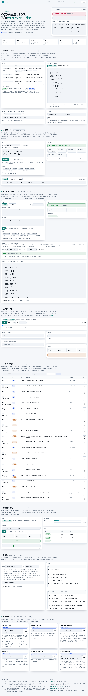

# InterJSON — LLM 输出的执行门 · 本地 MCP

**版本**：1.5.1

**技术预览（technical preview）**：GitHub `v1.5.0` 已发布（8 个产物）；mooncakes 上
`0.12.0` 已于 2026-10-28 发布；**npm 与 PyPI 上还没有 `interjson-moonbit`**（边界见本节末尾）。

[](https://github.com/wenhuang2333/Moonbit-haker/actions/workflows/ci.yml)
[](LICENSE)
[](https://wenhuang2333.github.io/Moonbit-haker/)

**InterJSON 是 LLM 输出的执行门：它判定模型给出的工具参数能不能被执行；不能执行时，它把要发回给模型的那句话一并返回。**

## 60 秒

**① 装。** 一条命令，装到 `~/.local/bin`（`INTERJSON_DIR` 可改）：

```bash
curl -fsSL https://github.com/wenhuang2333/Moonbit-haker/releases/latest/download/interjson-install.sh | sh
```

安装脚本只做四件事：判断平台、下载对应产物、拿 Release 自带的 `SHA256SUMS` 核对
SHA-256、把二进制放上 `PATH` 并打印该加的 `export PATH=...`。校验不通过就删除文件、
什么都不装。Release 工作流构建 **三个操作系统上的四个二进制**，安装脚本四个都覆盖：
`interjson-linux-x86_64`、`interjson-linux-arm64`、`interjson-macos-arm64`、
`interjson-windows-x86_64.exe`（另有 `interjson-probe.wasm`、
`interjson-demo.js`、`interjson-install.sh` 与 `SHA256SUMS`）。

**② 过门。** 模型被 `max_tokens` 截断，参数少了一个右花括号。真实用法是把它交给
**MCP 工具**（这才是产品面）：

```bash
interjson mcp --print-config=claude    # 打印 Claude Code 的配置
claude mcp add interjson -- interjson mcp
```

装好之后，执行任何工具调用前先调 `interjson_gate`，把参数原文和该工具的
`inputSchema` 一起传进去。**不接 MCP 也能直接验**——同一个判定在命令行上就能看到：

```bash
printf '{"amount":100,"currency":"USD"' | interjson explain --policy agent --json
```

`interjson_gate` 返回同一个判定，`content[0].text` 就是这一行摘要（真实输出，逐字）：

```text
decision=lossy_repair executable=false exactness=lossy
error=E010 E010 StrictViolation at 1:31 (offset 30): R009 CloseContainer: exactness lossy exceeds max_loss cosmetic
retry (send this back to the model): InterJSON refused the arguments: E010 R009 CloseContainer at line 1 column 31 (offset 30).
Reason: exactness lossy exceeds max_loss cosmetic
Context: nt":100,"currency":"USD"
                                 ^
Re-emit the arguments as valid JSON with exactly one reading.
```

`executable=false` 时不要执行。把 `retry.prompt` 原样发回模型，模型重发
`{"amount":100,"currency":"USD"}` 后再过一次门，`executable` 为 `true`。
机器可读的完整对象在 `structuredContent` 里（拒绝时 `value` 一定是 `null`，
`retry.prompt` 一定非空）。逐字事件流与四个工具的全部字段见
[code/docs/MCP.md](code/docs/MCP.md)。

**③ 接。** 模型侧一行；宿主侧一行（见下节「接入面」）：

```bash
claude mcp add interjson -- interjson mcp
```

**和 `jsonrepair` / `partial-json` / `moon_json_repair` 的一句话区别**：它们交付「更干净的
文本」，InterJSON 交付**判定**——能不能执行、不能执行时模型该改什么。修复得对只是入口：
`{"a":"b","a":"c"}` 是合法 JSON 却没有唯一含义，执行档下它被拒绝，而不是先执行再后悔。

> **技术预览的边界（如实说明）**
> - **原生二进制来自 GitHub Release**（上面那条安装命令）：三个操作系统、四个二进制
>   （linux-x86_64 / linux-arm64 / macos-arm64 / windows-x86_64）；
>   其他平台需要从源码构建。**没有 Intel macOS 产物**：MoonBit 工具链只发布
>   `darwin-aarch64`、`linux-x86_64`、`linux-aarch64`，那个平台连工具链都装不上。
> - **从源码构建需要 MoonBit 工具链 `moon 0.1.20261016`**（版本锁在仓库里，其他版本未验证）。
> - **mooncakes 上的 `0.12.0` 已于 2026-10-28 发布**（`moon add
>   zhanshishan/interjson`）；**npm 与 PyPI 上还没有 `interjson-moonbit`**，
>   两个语言包目前只能按仓库路径安装。
> - 引擎与全部不变量已由测试锁定（见[质量与证据](#质量与证据)），但对外包与 registry 渠道
>   尚未开放。

## 为什么需要它

LLM 的结构化输出经常不是合法 JSON：外面裹着 ``` 围栏、前面带一句「好的，这是你要的 JSON」、
用单引号、夹着 `//` 注释、尾逗号、`NaN`/`undefined`、被 `max_tokens` 截断在半个字符串中间。
严格解析器遇到这些直接抛错，而流式场景下应用只拿到前缀。TypeScript 与 Python 有成熟方案；
MoonBit 生态里已有 [`btlqql/moon_json_repair`](https://mooncakes.io/docs/btlqql/moon_json_repair@0.1.1)
（保守修复，明确声明 *"This implementation buffers input; it is not an unbounded streaming parser"*），
两者分工不同：

> **moon_json_repair 修的是已经写完的坏 JSON；InterJSON 修的是正在生成中的坏 JSON ——
> 模型每吐一个 token，应用就能多读到一点。**

三条不变量贯穿实现，并由属性测试强制：**输出合法**（修复后的文本一定可以被标准 JSON 解析器
接受）、**幂等**（再修一次不再产生任何改动）、**分块不变**（一次性喂入与任意切分逐块喂入，
文本、修复记录、错误完全一致）。

但「解析成功」不是终点。**InterJSON 不把「语法合法」当成「可以执行」**：
`{"a":"b","a":"c"}` 是合法 JSON（RFC 8259 允许重复键），却没有唯一含义；`{"path":"/tmp/x`
补上右引号就能解析，但补出来的内容不是模型说的。因此每个结果都带**精确度标签**
（`Exact` 没修 / `Cosmetic` 只改记法 / `Lossy` 发明或丢弃了信息）与**歧义类别**
（`none` / `syntactic` / `semantic`），执行档（`for_execution` / `for_agent`）下直接拒绝
有损或有两种读法的结果，并把拒绝理由变成可以直接回灌模型的句子。字段定义与判定格见
[code/docs/SPEC.md](code/docs/SPEC.md)。

## 接入面

四个接入面，按「谁来决定使用」区分。MCP 是模型自己能调用的面（也是本产品的默认入口）；
`serve` 与语言包是宿主侧的面：宿主在执行工具参数前过同一道门。逐工具配方见
[code/docs/INTEGRATIONS.md](code/docs/INTEGRATIONS.md)，部署细节与四个工具的全部字段见
[code/docs/MCP.md](code/docs/MCP.md)。

| 接入面 | 命令 / 包 | 适合 | 谁调用 |
| --- | --- | --- | --- |
| **MCP** | `interjson mcp`（别名 `interjson-mcp`） | Claude Code、Cursor、Codex CLI、Gemini CLI、Cline、Windsurf、Zed | 模型主动调用（**建议性**） |
| **Claude Code hook** | `.claude/settings.json` 的 `PreToolUse` | Claude Code | 宿主强制（工具执行前） |
| **长驻协议** | `interjson serve` | 任何能起子进程的语言；高频/流式 | 宿主应用 |
| **语言包** | `npm install ./code/npm` / `pip install ./code/python` | Node / Python 宿主 | 宿主应用 |
| **HTTP** | `interjson-http --port 8080` | n8n、Dify、Coze、网关 | 宿主应用 |

MCP 暴露四个只读工具：`interjson_gate`（执行门，首选，不传 `profile` 时默认 `agent`）、
`interjson_repair`、`interjson_validate`、`interjson_readiness`。协议版本 `2025-06-18`，
同时接受 `2025-03-26` 与 `2024-11-05`；`content[0].text` 是给模型读的摘要，
`structuredContent` 是同一个判定的机器可读版本（只出现一次）。四个工具的字段、错误码与
逐客户端配置见 [code/docs/MCP.md](code/docs/MCP.md)。

> npm / PyPI 上的发行名是 **`interjson-moonbit`**（后缀标识 MoonBit 引擎），但**两个渠道
> 都还没有发布**；mooncakes 上的 `0.12.0` 已发布，二进制从 GitHub Release 装（上面那条
> `curl`）。语言包目前只能按仓库路径安装（上表两条命令），Python 的 import 名仍是 `interjson`。

> **MCP 是建议性的，不是强制的（如实说明）**
> `interjson_gate` 是**模型可以选择调用的一个工具**。模型可以不调用它，宿主也没有任何机制
> 强制它在执行前调用。因此「接了 MCP」等于「多了一个可用的检查点」，**不等于**「参数一定
> 过了门」。真正把它变成**强制闸门**的是宿主侧：Claude Code 的 `PreToolUse` hook（配方见
> [code/docs/INTEGRATIONS.md](code/docs/INTEGRATIONS.md#making-the-gate-mandatory)）、
> 宿主 SDK 里的一行 `gate(args) -> execute | retry`，或者 `interjson serve` / npm / pip / HTTP
> 这几条宿主侧通道——它们在宿主执行之前运行，不依赖模型自觉。

## 快速开始（库与命令行）

```bash
# 1. 安装工具链（若尚未安装）
curl -fsSL https://cli.moonbitlang.com/install/unix.sh | bash
export PATH="$HOME/.moon/bin:$PATH"

# 2. 构建与测试（HTTPS 可直接匿名克隆；SSH 用 git@github.com:wenhuang2333/Moonbit-haker.git）
git clone https://github.com/wenhuang2333/Moonbit-haker.git
cd Moonbit-haker/code
moon check --deny-warn   # 0 warning
moon test                # 249 个测试全部通过（四个后端同一套）
```

```moonbit
// 3. 一次性修复
let r = @interjson.repair("{'a':1,}")
// r.text    == {"a":1}
// r.repairs == [R003 1:2 quote normalized to double quote,
//               R005 1:7 extra comma removed]

// 4. 流式部分解析：边生成边用
let p = @interjson.PartialParser::new()
p.feed("{\"name\":\"Mo")
p.snapshot()          // {"name":"Mo"} | Partial | name
p.feed("onBit\",\"tags\":[\"json\"]}")
p.finish()            // Complete, {"name":"MoonBit","tags":["json"]}

// 5. 执行安全闸：只接受没有信息损失的修复
let safe = @interjson.Options::for_execution()   // max_loss: Cosmetic
let q = @interjson.PartialParser::new(options=safe)
q.feed("{\"path\":\"/tmp/x\"")   // 截断在字符串中间
q.finish()            // 抛 E010：CloseString 会补内容，超出 Cosmetic

// 6. 大模型工具流：直接吃 provider 的事件
let s = @llm.ToolStream::new(@llm.Anthropic)
for v in s.push_event("{\"type\":\"content_block_delta\",...}") {
  // v.snapshot.value 是当前参数，v.exactness 是当前标签，v.done 表示调用已结束
}
```

库的完整 API（`Options` 全部字段、`Schema`、快照语义、修复记录与错误码、CLI 全部选项）
见 [code/README.md](code/README.md)（英文，mooncakes 包页渲染的就是它）与
[code/README.zh.md](code/README.zh.md)（中文 API 速查）。

宿主侧的推荐写法（Python）：

```python
from interjson import Client

with Client() as jm:
    plan = jm.analyze(model_text, profile="agent", schema_json=tool["inputSchema"])
    if not plan["executable"]:
        return retry_with(plan["retry"]["prompt"])
    execute(json.loads(plan["text"]))
```

`schema_json` 直接吃工具已有的 JSON Schema 子集（`type`/`properties`/`required`/
`items`/`enum`/`const`/数值与长度约束/字符类 `pattern`），不需要把声明翻译成 InterJSON 的 DSL；
不支持的键（`$ref`、`oneOf` 等）会报 `E070`，而不是静默忽略。

**安全默认**：库默认 `permissive`（显示通道该尽量修）；任何**执行**路径必须显式传
`profile="agent"` 或 `"execution"`，否则这道门只是建议。MCP 的 `interjson_gate` 是唯一
的例外：它默认 `agent`，而且这个 `agent` 档现在**等于** `Options::for_agent()`（含
`skip_prose`：模型在参数前写一句「这是参数：」不再被拒）。

## 功能一览

| 能力 | 说明 |
| --- | --- |
| **安全档位** | `SafetyPolicy` 五档（`permissive`/`interactive`/`execution`/`agent`/`strict`）；`with_policy` 只换安全字段、保留协议字段，`with_profile` 连该档的协议一起给，`of_options` 可反查 |
| **一次调用拿到计划** | `analyze(input, options?, readiness?, schema?)` → `RepairPlan`：决策、修复操作、重试提示、JSON 通道；**永不抛错** |
| **执行决策** | `ExecutionDecision` 五态（`safe`/`cosmetic_repair`/`lossy_repair`/`ambiguous`/`invalid`），风险可排序 |
| **骨架感知就绪** | `Schema` 文本 DSL + `semantic_readiness`：同一条流上给出「语法就绪」与「骨架就绪」两个分数，以及缺失/类型不符清单 |
| **JSON Schema 桥** | `Schema::of_json_schema` / `parse_json_schema`：直接吃工具声明的子集；不支持的键报 `E070` |
| **长驻协议** | `interjson serve`：版本化 JSONL，`repair`/`analyze`/`validate`/`readiness`/`watch.*`/`llm.*`；stdout 只走协议，逐行 flush（[code/docs/PROTOCOL.md](code/docs/PROTOCOL.md)） |
| **MCP server** | `interjson mcp`（别名 `interjson-mcp`）：四个只读工具，stdio JSON-RPC 2.0，`--print-config` 打印七种客户端配置（[code/docs/MCP.md](code/docs/MCP.md)） |
| **语言包** | npm（ESM/CJS/类型）与 pip（薄客户端 + HTTP facade），包装同一份引擎 |
| 一次性修复 / 流式部分解析 | `repair` 返回文本、`Json` 值与逐条记录；`PartialParser::feed`/`feed_bytes`/`snapshot`/`finish`，快照是稳定前缀 |
| 22 条修复规则 / 12 个错误码 | R001–R022 逐条可关（表由 `RepairCode::count()` 定尺寸）；E001–E070 含位置与上下文片段 |
| 精确度与增量流 | `Exact`/`Cosmetic`/`Lossy` 进入全部四个结果类型，`max_loss` 是执行前的闸门；`collect_deltas` 后 `drain_deltas()` 返回 `Set`/`AppendText`/`Close`（RFC 6901 指针） |
| 大模型工具流适配 | `interjson/llm`：Anthropic 细粒度工具流与 OpenAI 兼容流，支持多路并发与 SSE 解析 |
| 资源上限与多后端 | `max_depth`/`max_input_len`/`max_token_len`（`E020`/`E021`/`E022`）；wasm-gc / native / JS / wasm 四个后端测试结果一致，CLI 为 native |

完整选项表、22 条规则的逐条说明与 12 个错误码见
[code/README.md](code/README.md#options)——那是发布的表，读者直接能看。更长的规则字典
（带示例、需求映射、失效模式）在仓库内维护，不随包发布。

## 质量与证据

| 项目 | 规模 | 结果 |
| --- | --- | --- |
| 黄金用例（项目文档附录 A、B） | 126 条 | 全部通过 |
| 流式用例（S-001…S-021）与分块不变性 | 21 条 + 逐码元/二分/1 KB 切分 | 通过 |
| 增量流视图 | `drain_views` / `for_each_delta` 与 `drain_deltas` 逐字段比对（120 份文档 × 7 组选项 × 2 语料） | 一致，路径解码逐段相同 |
| 属性与模糊测试 | 8 组 × 400 例（`INTERJSON_LONGRUN` 可提高，夜间跑 1 000 000 例）；字节级 fuzz 5 组 × 300 例（CI 2 000、夜间 100 000） | 通过，无反例 |
| 真值评测（协议先冻结） | 1200 条（19 个变异族 + 1 个对照组，每族 60 条） | 恢复率 **100.00%**；差异 0 条，所以**漏标率是 n/a（0/0）而不是 0**——一个没有分母的比率写成 0 会让人以为测出了一个零。四条预登记判据 + 3b 子判据全 PASS |
| 自愈闭环 | `examples/agent_loop` 4 个 episode | 2 次重试后执行、1 次骨架不符回灌、1 次无改进则放弃 |
| 增量流重放 | 400 份生成文档 + 400 份变异输入 | 「增量重放 == 快照」全部成立 |
| 大模型适配器 | 9 个夹具 × 双 provider | 通过（含截断、转义切分、代理对切分、多路并发） |
| 公共面与选项测试 | 22 个 R 码 + 12 个 E 码逐一检查 | 通过 |
| 四个后端 | wasm-gc / native / JS / wasm（每条命令跑同一套测试） | 各 249/249 通过（共 996 次） |
| 命令行冒烟 | 122 项断言（含全部退出码、`llm` 子命令、`explain`、6 项版本一致性与四个资源上限开关的正反两侧） | 通过 |
| **协议一致性** | 19 组 `serve`/MCP 用例（`tests/conformance/`） | 全部通过；Linux/macOS/Windows 同一套 |
| **npm 包** | 15 个 Node 测试（ESM/CJS/类型/无 stdout 污染，含 MCP 启动器） | 通过 |
| **Python 包** | 20 个测试（客户端 14 + HTTP 6） | 通过 |
| 示例对照 | 6 组输入/期望输出 | 逐字节一致 |
| 差分测试（对照 `jsonrepair`、`json-repair`） | 402 条用例 | 202 处差异**全部有文档解释**，未解释 0 |
| 库代码行覆盖率 | 根包 4032/4299、`llm` 包 337/391 | 93.8% / 86.2%；覆盖率门按「有未覆盖行的文件」口径计 4294/4615 = **93.0%** |
| **独立第三方语料** | `nst/JSONTestSuite` 318 文件（MIT，commit `1ef36fa0`） | `y_` 误修 **2/95**（重复键），`n_` 有效值 **165/188** vs `json_repair` 166、`jsonrepair` 144 |
| **骨架就绪表** | 10 个场景 | 6 个存在落差（最小 713‰、最大 **908‰**），4 个两层同时到达末尾 |
| **安全层单价** | 4.9 KiB × 20 次调用 | `analyze` = `repair` 的 0.95–1.01×，`for_agent` 1.05–1.12×，`+schema` 1.06–1.12× |
| 吞吐（Apple M5，release，单机多次观测中位数） | 合法 JSON native 42–47 MB/s、JS 30–38 MB/s | 达标（阈值 20 / 5；10 MB 档 native 45.3、JS 23.2 MB/s） |
| 首个可见值（流式） | 工具调用文档中位数 | 文档长度的 **0.7%** 处即可渲染，并同时拿到标签 |
| 命令行吞吐（12.95 MiB 输入，64 KB 分块） | 35.0–36.7 MB/s（峰值 RSS 177.9 MB） | `Position` 不再逐码元构造后 +25% |
| 长文本输入（单条字符串吃掉整篇文档） | 4 Mi 码元 CJK：`feed_bytes` **209.7–220.8 Mu/s**（修复前 38.5–39.6）；CLI 读 25.17 MB 单条 CJK 字符串 0.04 s、`--check` 峰值 RSS 46–54 MB（1.9–2.2 × 输入） | 字节入口对完整 UTF-8 序列批量并入；按字节算 CJK 与 ASCII 同价（662 / 599 MB/s） |
| wasm-gc 产物体积 | 114.5 KiB（`bash code/tests/bench.sh size`） | 达标（上限 150 KB） |

```bash
cd code
moon test && moon test --target native && moon test --target js
bash tests/cli_smoke.sh && bash tests/examples.sh
python3 tests/conformance/run_conformance.py --cli ./_build/native/release/build/cmd/interjson/interjson.exe
(cd python && python3 -m unittest discover -s tests)
(cd npm && node --test)
node tests/demo_smoke.mjs
python3 tests/diff/run_diff.py --cli ./_build/native/release/build/cmd/interjson/interjson.exe
python3 tests/eval/run_eval.py --cli ./_build/native/release/build/cmd/interjson/interjson.exe
python3 tests/gen_llm_fixtures.py --check
```

以上命令（含差分、真值评测与产物体积）也在 `.github/workflows/ci.yml` 中按同样的版本执行，
`release.yml` 的 `publish` 依赖 `[web, cli, test]`，其中 `test` 直接调用 `ci.yml`
（`workflow_call`）——**打了标签不等于测试红了也能发**。表里的每一个数字都由
`bash code/tests/claims.sh` 从当前构建重新推导后回查本文，文档里的数字错了就是门失败。

## 演示页

**线上（一键打开）**：<https://wenhuang2333.github.io/Moonbit-haker/> —— `index.html` 交互控制台
· 逐帧演示 <https://wenhuang2333.github.io/Moonbit-haker/live.html>
· MCP 接管演示 <https://wenhuang2333.github.io/Moonbit-haker/mcp.html>

页面里的每一帧都来自同一个 `PartialParser` 与 `analyze`，用 MoonBit 编译成的 `interjson.js`
在浏览器里直接跑；**没有第二个解析器，也没有为演示写的特例**。`static/demo/index.html` 是
交互控制台（本地 MCP 执行门、修复工作台、执行门、流式重放、22 条规则一键试用、字段就绪曲线、
CLI 命令构造器与退出码表、六种接入方式），`static/demo/live.html` 是四条真实场景的逐帧重放，
`static/demo/mcp.html` 重放一次真实的 Claude Code 会话。直接用浏览器打开即可，无需服务器；
重新生成 bundle 用 `bash static/demo/build.sh`。



**真实 Claude Code 会话**：[`static/demo/mcp-claude-session.txt`](static/demo/mcp-claude-session.txt)
是逐字节的原始事件流（会话 id、时间戳、工具入参、工具返回、重试提示），
[`mcp-claude/README.md`](static/demo/mcp-claude/README.md) 写了它是怎么录的、怎么复现，
以及它有哪些限制。

> **关于模型（如实说明）**：客户端与 MCP 协议是 Anthropic 的真货，但录制时本机的
> `ANTHROPIC_BASE_URL` 指向第三方网关，所以**驱动那段会话的权重不是 Anthropic 的**
> （会话记录里写着实际模型名与 `modelUsage`）。把那个 `env` 换成 Anthropic 端点、
> 重跑 `code/tests/media/record_claude_mcp.py`，得到的就是 Claude 模型的会话。**引擎那一侧
> 百分之百是真的**——E010 与放行都是本仓库的 `interjson` 自己判的。

**录屏**：[`static/demo/demo.mp4`](static/demo/demo.mp4)（80 秒：live.html 四场景 +
`examples/agent_loop` 自愈闭环 + 一条 `explain --json`）。本机打开（Pages 不可用时的等价方案）：

```bash
python3 -m http.server 8000 -d static/demo   # 打开 http://127.0.0.1:8000/live.html
```

## 与参照实现的差异

不是移植，也不追求逐字节一致。差分测试里约一半用例结论不同，全部落在四类**有意**的策略差异上：

1. **截断处的补全策略**：补 `null` 并闭合容器，而不是猜一个空字符串或把片段变成数组元素；
2. **多根值**：默认只保留第一个值，`--multi-root array` 可切换为合成数组；
3. **字面量与非有限值**：`tru`→`true`、`NaN`/`Infinity`/`undefined`→`null`，裸词加引号；
4. **范围外输入**：没有任何 JSON 值时返回 `E001`/`E002`，而不是凭空造一个值。

402 条用例的逐条归因见 [code/docs/DIVERGENCES.md](code/docs/DIVERGENCES.md)。同赛道已有
[`btlqql/moon_json_repair@0.1.1`](https://mooncakes.io/docs/btlqql/moon_json_repair@0.1.1)
（Apache-2.0，零第三方依赖，带可重放编辑与 JSONL 批处理）；下表按**对方 README 的原文声明**
与本仓库的实测行为逐项对照（对方信息于 2026-10-15 抓取 mooncakes 页面核对）：

| 能力 | InterJSON 1.5.0 | moon_json_repair@0.1.1 |
| --- | --- | --- |
| 定位 | 流式：边到达边解析，并给结果打精确度标签；执行前判定能不能执行 | 保守修复：已写完的文本，明确拒绝边界 |
| 增量 `feed` / `snapshot` | 有（任意切分结果一致） | 无（原文：*"it is not an unbounded streaming parser"*） |
| 精确度标签 + 执行闸 | 有（`Exactness` + `max_loss`，超限抛 `E010`） | 无（原文：*"Repair success only establishes JSON syntax…"*） |
| 增量补丁流（`Set`/`AppendText`/`Close` + JSON Pointer） | 有（`collect_deltas`） | 无 |
| LLM provider 事件适配（Anthropic / OpenAI、SSE） | 有（`interjson/llm` + `interjson llm`） | 无 |
| 缺中间逗号 / 冒号 / 值 | 修复（R005/R006/R007/R008） | 原文："Missing middle commas/colons/values … fail" |
| 截断补全 / 重复键 | 闭合容器与字符串、补全字面量、缺值补 `null`；重复键合并（R018，策略可选） | 只在 relaxed 下闭合容器；"never completes strings…"；"duplicate keys … fail" |
| 可重放编辑 / 库内 JSONL 批处理 | **无**（CLI 有 `--batch`，那是评测用的一次性批量） | **有**（`apply_edits`、`repair_jsonl`） |

客观地说，对方的**可重放编辑**与**库内 JSONL 批处理**是 InterJSON 目前没有的能力；而
InterJSON 的差异化压在它的边界上：**流式增量**、**截断补全**、**更宽的修复面**、
**可审计的记录**，以及**精确度标签**与**provider 适配**。

## 已知限制

- **内存：长文本与标量已进入 4 倍预算，值密集的容器不在。** 两个口径都要看：
  - `docs/MEMORY.md` 的基准形状（12.95 MB 对象数组，每对象约 12 个成员）：
    `repair()` 13.2 倍、`--check` 7.5 倍；同字节量的**长文本**形状 `--check`
    只有 **3.6 倍**，`repair` 约 90 MB。
  - `code/tests/memory_gate.py` 的值密集形状（20 万元素，边际峰值 ÷ 输入）：
    纯整数 **5.2 倍**、浮点 7.7 倍、字符串 6.5 倍；`{"a":1}` 重复 **24.1 倍**、
    `[1]` 重复 24.1 倍、`[[1]]` 重复 26.8 倍。
  容器的倍数不是解析器写得不好，是 `Json` 类型的成本：一个 `{}` 就是一次 `Map` 分配、
  一个 `[1]` 就是一次 `Array` 分配加一个装箱的 `Json`，输入却只有三个字节。
  **要覆盖容器，必须有「不建树」的模式**；它没有实现，设计与实测目标写在
  [code/docs/NOTREE.md](code/docs/NOTREE.md)。这组倍数现在由
  `code/tests/memory_gate.py` 守门（CI 里跑），涨过记录的天花板就失败——此前
  `docs/MEMORY.md` 里的数字只是被打印，漂了没人发现。
- **`max_depth` 可以放宽了。** 值上的四个遍历（拷贝、判等、骨架求值、渲染）都改成了迭代，
  深度由堆而不是原生栈决定，所以 10 万层的文档四个后端都能解析。`MAX_VALUE_DEPTH`
  现在是防笔误的理智上界（超过报 `E050`）。**声明**仍由两个递归解析器读，
  `MAX_SCHEMA_DEPTH = 256` 是真上界（超过报 `E070`）——这是目前唯一还受栈限制的地方。
- **增量流的吞吐是基线耗时的 1.39–1.51 倍（native）**，未达到「不低于基线 90%」的目标：
  每条变更都要分配一个 `Delta` 与一份路径数组；1.1.x 起文本尾巴用游标推进（1 MiB / 64 码元：
  374 ms → 201 ms），但每条 `Delta` 的分配未变。
- **骨架约束是字符类子集，不是正则**：支持 `minimum`/`maximum`/`exclusiveMinimum`/
  `exclusiveMaximum`/`minLength`/`maxLength`/`enum`/`pattern`，但 `pattern` 只接受 `[...]`，
  没有 `*`/`+`/`?`/`|`/锚点/分组，也没有 `$ref`/`oneOf`/`format`（见
  [code/docs/SPEC.md](code/docs/SPEC.md)）。
- **`semantic_readiness` 与 `repair` 同量级**（约 116–170 µs / 4.9 KiB，`repair` 的 1.1–1.7 倍）；
  热路径应使用增量观察器（`SemanticWatcher` / `FieldTracker`），它不做快照。
- **`Options::for_text()` 是预设，不是无树引擎**：关掉记录与缩进，但值仍然建树；
  真正的「只出文本」模式（`want_value = false`）仍未实现。
- **前言重放只接受「整段前言被读成一个值且没有 `R016`」**：`'ok'`、`True`、`+1`、
  `42 // done`、围栏标量都能恢复；标量根前言（`Sure!\n42`）与带尾巴的 `42 is the answer`
  仍**有意拒绝**（前言在哪里结束不可判定）。前言超过 `max_prose_buffer`（64 KiB）时回退 `E002`。
- **MCP 是建议性的**：`interjson_gate` 是模型可以选择调用的工具，协议层没有强制点；
  要变成强制闸门用 `PreToolUse` hook、宿主 SDK 的 `gate(args)`，或 `serve` / npm / pip / HTTP。
- **`serve` / `mcp` 每条连接只支持一个 `watch` 流和一个 `llm` 流**，且只有本地 stdio 一种传输
  （MCP 请求行上限 8 MiB）；并发多流需要多条连接。
- **JSON Schema 桥是受控子集**：`$ref`、`oneOf`/`anyOf`/`allOf`、`not`、`format`、
  `patternProperties`、`minItems` 等会报 `E070`；`additionalProperties: false` 也拒绝。
- **命令行仅支持 native 后端；解析器实例非线程安全**，每个流用一个实例；恢复策略是启发式的，
  不是某个标准的合规实现。

完整清单（含 1.4.x → 1.5.x 的契约变化与逐条边界）见
[code/README.md#known-limitations](code/README.md#known-limitations)。需求 → 用例 → 证据的
追踪矩阵在仓库内维护，不随包发布。

## 文档索引

**随仓库发布的文档**（在 GitHub 上可以直接打开）：

| 文档 | 内容 |
| --- | --- |
| [code/README.md](code/README.md) / [code/README.zh.md](code/README.zh.md) | 英文完整 API 参考（mooncakes 包页渲染它）/ 中文 API 速查 |
| [code/docs/MCP.md](code/docs/MCP.md) | **本地 MCP 部署指南**：为什么本地、安装路径、逐客户端配置、四个工具与一次 `interjson_gate` 示例、安全模型、故障排查 |
| [code/docs/INTEGRATIONS.md](code/docs/INTEGRATIONS.md) | 逐工具接入配方：MCP、Claude Code hook、Python、Node、HTTP、流式、安全默认 |
| [code/docs/PROTOCOL.md](code/docs/PROTOCOL.md) | **协议 v1**：`serve` 的帧、方法、错误、版本与限制 |
| [code/docs/CONFORMANCE.md](code/docs/CONFORMANCE.md) | 一致性套件：用例格式、覆盖范围、如何新增 |
| [code/docs/SPEC.md](code/docs/SPEC.md) | **规范**：三档就绪、delta 契约、精确度格、四个执行字段、骨架文法，逐条编号 `SR-n` |
| [code/docs/EVAL.md](code/docs/EVAL.md) · [EVAL_INDEPENDENT.md](code/docs/EVAL_INDEPENDENT.md) · [EVAL_PATHS.md](code/docs/EVAL_PATHS.md) · [EVAL_AMBIGUITY.md](code/docs/EVAL_AMBIGUITY.md) · [EVAL_REFERENCE.md](code/docs/EVAL_REFERENCE.md) | 真值评测、独立第三方语料、分块/适配器路径、对抗歧义、参照库对照（生成物） |
| [code/docs/EVAL_REGISTRATION.md](code/docs/EVAL_REGISTRATION.md) | 真值评测的预登记协议（数据集、判据、修订记录） |
| [code/docs/READINESS.md](code/docs/READINESS.md) · [code/docs/MEMORY.md](code/docs/MEMORY.md) | 骨架就绪表、各模式内存基线（生成物） |
| [code/docs/DIVERGENCES.md](code/docs/DIVERGENCES.md) | 与两个参照实现的逐类差异与归因（生成物） |
| [code/CHANGELOG.md](code/CHANGELOG.md) | 版本变更（每个 Release 的正文由它抽出） |
| [code/SECURITY.md](code/SECURITY.md) | 威胁模型：不可信输入的保证、递归与资源上界、模糊测试的真实预算、MCP 的建议性边界 |
| [code/CONTRIBUTING.md](code/CONTRIBUTING.md) | 开发环境、测试命令、新增规则的流程 |
| [code/npm/README.md](code/npm/README.md) · [code/python/README.md](code/python/README.md) | 语言包接入说明（npm / PyPI 包页读的就是它们） |
| [static/demo/README.md](static/demo/README.md) · [static/demo/mcp-claude/README.md](static/demo/mcp-claude/README.md) | 演示页与真实 Claude Code 会话的说明 |

**本地文档**（设计文档与交付文档，只在作者本机保留；不随仓库发布）：

| 文档 | 内容 |
| --- | --- |
| [code/README.md](code/README.md) | 库 API：`Options`、`PartialParser`、`Schema`；**22 条规则与 12 个错误码的完整表** |
| [code/README.zh.md](code/README.zh.md) | 同上（中文） |
| [code/docs/MCP.md](code/docs/MCP.md) | 本地 MCP 部署指南：四个工具、`outputSchema`、错误码、安装 |
| [code/docs/INTEGRATIONS.md](code/docs/INTEGRATIONS.md) | 宿主侧接入配方，含把门变成强制点的 `PreToolUse` hook |
| [code/docs/PROTOCOL.md](code/docs/PROTOCOL.md) | `serve` 的线格式契约 |
| [code/docs/CONFORMANCE.md](code/docs/CONFORMANCE.md) | 协议与 MCP 一致性套件的规范 |
| [code/docs/SPEC.md](code/docs/SPEC.md) | 兼容性契约 |
| [code/docs/NOTREE.md](code/docs/NOTREE.md) | 无树模式的设计与实测目标（**未实现**） |
| [code/SECURITY.md](code/SECURITY.md) | 威胁模型、递归上界、fuzz 预算 |
| [code/CONTRIBUTING.md](code/CONTRIBUTING.md) | 改引擎前的硬约束 |
| [code/CHANGELOG.md](code/CHANGELOG.md) | 逐版本变更 |
| [code/docs/MEMORY.md](code/docs/MEMORY.md) · [DIVERGENCES.md](code/docs/DIVERGENCES.md) · [EVAL.md](code/docs/EVAL.md) | 生成物：内存基线、差分报告、真值评测 |
| `marks/发布前清单.md` | 本轮的评审清单与验收记录（驱动 1.5.0 的那份） |
| `产品文档.md` · `marks/` | **历史档案（旧版）**：更名前的逐轮快照、问题与决策，以及早期设计文档；仅追溯用 |

> 为什么分两类：设计文档与交付文档属于过程材料，按项目约定不随代码仓库发布
> （`.gitignore` 用白名单管文档，新文档默认不上传）；**接入方需要的** MCP 部署指南、
> 接入配方、协议与一致性规范、威胁模型、规范与贡献流程，以及全部测量报告，都在第一张表里
> 随仓库发布——判据、数据与线格式不会只留在某个人手里。放行一篇文档等于把它里面的数字
> 交给 `code/tests/claims.sh` 守。

## 发布通道与版本映射

同一份代码发布到两个渠道，版本号按下面的映射一一对应，`git diff` 可核对两边
**字节级一致**（唯一差异是版本字符串本身）：

| GitHub tag | mooncakes.io | 关系 |
| --- | --- | --- |
| `v1.5.1` | `0.13.0` | **当前版本**：1.5.0 的 tag 打出去之后才完成的深度与内存工作，单独成版——**tag 是发布物，分支是后来者**，而 1.5.0 的二进制与 1.5.0 的文档说的不是同一件事。值上的四个遍历（拷贝、判等、骨架求值、渲染）改为迭代，深度由堆而不是原生栈决定，`MAX_VALUE_DEPTH` 从 512 提到 1048576，**10 万层的文档四个后端都能解析**；数值不再为可往返的源文本分配 `String`，容器按实际内容定尺寸，渲染器改游标。实测整数 9.7 → 5.2 倍、嵌套数组 47 → 24 倍。新增 `tests/memory_gate.py` 进 CI。`1.5.1` ↔ `0.13.0`；**0.13.0 已上传 mooncakes（2026-10-29）** |
| `v1.5.0` | `0.12.0` | 1.5.0 发布时的内容：修两处「错误放行」——`json_equal` 改为按数字的精确十进制值比较（`9007199254740993` 与 `9007199254740992` 不再被当成同一个值），`RuleSet` 由 `RepairCode::count()` 定尺寸并改为 fail-closed（`R022` 此前无法被关闭）；修拒绝契约（不可执行的结果必带非空 `retry.prompt` 且 `value` 为 `null`）；MCP `agent` 档改为等于 `Options::for_agent()`（含 `skip_prose`）；CLI 修 `--max-repairs` 上限、`--max-prose-buffer=` 少切一位、`--print-config` 空格形式；stdin 跨 64 KiB 边界的多字节字符不再损坏。`1.5.0` ↔ `0.12.0`；**0.12.0 已于 2026-10-28 上传 mooncakes**，GitHub `v1.5.0` Release 已发布 7 个产物 + `SHA256SUMS` |
| `v1.4.0` | `0.11.0` | 更名 InterJSON，产品定位为「LLM 输出的执行门」，对外主入口改为本地 MCP server（`interjson mcp`，四个只读工具，主工具 `interjson_gate` 默认 `agent` 档）。模块、CLI、语言包与浏览器 bundle 统一改名，包名改为 `zhanshishan/interjson`；引擎语义、修复规则与全部不变量不变。mooncakes 现阶段只接受 `0.x.y`：patch 位一一对应，minor 位按发布序顺延（`1.0.x` ↔ `0.7.x`、`1.1.x` ↔ `0.8.x`、`1.2.x` ↔ `0.9.x`、`1.3.x` ↔ `0.10.x`、`1.4.x` ↔ `0.11.x`）。**0.11.0 已于 2026-10-27 上传** |
| `v1.3.0` | `0.10.0` | 三块结构性重构（当前位置与历史位置分离、增量日志改并行数组 + 路径 arena、CLI 暴露三个资源上限）加一处字节入口缺陷修复。0.10.0 未上传 mooncakes |
| `v1.2.0` | `0.9.0` | 修 89 条标量根误拒、按值分级 `R011`、加速 CLI 字节路径与增量文本 drain，并让默认路径执行 `--schema`。0.9.0 未上传 mooncakes |
| `v1.1.1` | `0.8.1` | 补丁版；修好 1.1.0 的 Release 漏挂 Windows 产物，并补齐演示资产与文档数字 |
| `v1.1.0` | `0.8.0` | 接入面首发（`serve`/`mcp`/npm/pip/Windows + JSON Schema 桥） |
| `v1.0.0` | `0.7.0` | 公开面冻结版；行为与 1.1.x 相同（除新增接入面） |
| `v1.0.1` | `0.7.1` | 补丁通道（未使用） |

GitHub 侧 `v1.4.0` 之前的 Release 都在旧包名 `zhanshishan/jsonmend` 下打的，资产沿用
`jsonmend-*` 前缀；`0.3.0` … `0.8.1` 也在旧包名下。**版本只有一个来源**：
`code/version.mbt` 的 `VERSION` / `REGISTRY_VERSION`；`code/moon.mod`、`code/npm/package.json`、
`code/python/pyproject.toml` 是三个编译器够不到的字面量，`tests/cli_smoke.sh` 断言四处相等，
`tests/claims.sh` 断言文档引用同一个数字。发布顺序：**先 `moon publish --dry-run` 探测平台
限制，再打标签**——标签一旦推送不再移动；Release 的资产是否与 `SHA256SUMS` 一致，由
`code/tests/release_assets.sh` 检查。逐条复现步骤在仓库内的 `code/docs/REPRODUCE.md`
（不随包发布；`README.md` 与 `code/README.md` 里的命令就是它的可执行部分）。

## 路线图

- **无树「只出文本」模式**（`Options.build_value = false`）：目前**没有**该字段，引擎一律建树；
  这是容器内存未达标的根因。设计、四处需要值的点、以及验收用的差分判据写在
  [code/docs/NOTREE.md](code/docs/NOTREE.md)——它记录的是"怎么做、做到什么算成功"，
  不是"已经做了"。
- **JSONL 流式模式**：每行闭合即交付一个值（对方是整批缓冲，这里是增量）。
- **快照增量子树缓存**（`Frame.dirty` 已存在但未使用）：把「每 1024 码元一次快照」的 2 倍
  惩罚降下来。
- **`out_range` 诊断（I-5）**：`--explain` 已落地，位置越界的分类尚未实现。
- **增量流再降本**：剩余成本是每条变更的日志追加，再降只能减少记录条数，而条数由
  `Set.at` 的「分块无关时间轴」承诺锁定，属 2.0 的破坏性变更。

## 许可与致谢

Apache-2.0，见 [code/LICENSE](code/LICENSE) 与 [code/NOTICE](code/NOTICE)。
测试使用 [`jsonrepair`](https://www.npmjs.com/package/jsonrepair)（ISC）与
[`json-repair`](https://pypi.org/project/json-repair/)（MIT）作为**进程外**差分参照，
其代码不进入本仓库或任何构建产物。

---

<a id="english"></a>

## English

**InterJSON is the execution gate for LLM output.** It ships as one local native binary
(pure-MoonBit engine) that speaks the Model Context Protocol over stdio: `interjson mcp`.
Before a host executes tool arguments, the gate answers one question — *may I execute this?* —
and when the answer is no, it returns the prompt to send back to the model. It also does the
repair underneath: fences, single quotes, comments, trailing commas, Python literals, and
truncation at `max_tokens`. Repair is the entrance, not the product.

```bash
curl -fsSL https://github.com/wenhuang2333/Moonbit-haker/releases/latest/download/interjson-install.sh | sh
claude mcp add interjson -- interjson mcp
```

- **Local by construction**: stdin/stdout JSON-RPC 2.0, no socket, no network, no API key.
- **Four read-only tools**: `interjson_gate` (defaults to the `agent` profile, which refuses a
  lossy or ambiguous repair instead of guessing), `interjson_repair`, `interjson_validate`,
  `interjson_readiness`; protocol `2025-06-18` (also `2025-03-26`, `2024-11-05`).
- **MCP is advisory, not mandatory** — a `PreToolUse` hook, a host-SDK `gate(args)` call, or
  `interjson serve` / npm / pip / HTTP is what makes it mandatory.
- **Verified**: 249 tests on each of four backends, 122 CLI assertions, 19 conformance groups,
  15 npm and 20 Python tests, 1200 preregistered ground-truth cases at 100.00% recovery, and a
  402-case differential corpus in which every one of the 202 divergences is documented.

Full English API reference (Options, `PartialParser`, `Schema`, rules, errors, CLI):
[code/README.md](code/README.md). MCP deployment guide: [code/docs/MCP.md](code/docs/MCP.md).
License: Apache-2.0.
