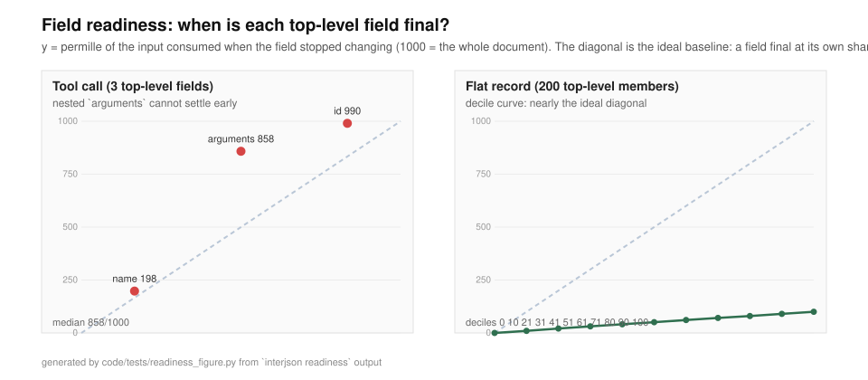

# JSONMend

Streaming JSON repair and partial parsing in pure MoonBit.

| | |
| --- | --- |
| Module | `zhanshishan/jsonmend` |
| Version | 0.5.0 |
| License | Apache-2.0 |
| Preferred target | `wasm` (also builds for `native` and `js`) |
| Prebuilt binaries | [Release `v0.5.0`](https://github.com/wenhuang2333/Moonbit-haker/releases/tag/v0.5.0) — Linux CLI, wasm probe, browser bundle, `SHA256SUMS` |
| Registry | [mooncakes.io `zhanshishan/jsonmend`](https://mooncakes.io/docs/zhanshishan/jsonmend) |

## Features

### 0.5.0: "may I execute this" in one call

- **`SafetyPolicy`**: five named profiles — `permissive`, `interactive`, `execution`, `agent`,
  `strict` — over the safety-relevant `Options`. `Options::with_policy` replaces only the safety
  knobs and keeps the protocol ones (delta stream, prose handling), and
  `SafetyPolicy::of_options` reads a set of options back to the profile it is (or `None`).
- **`analyze` returns the whole plan**:

  ```moonbit
  let plan = @jsonmend.analyze(text,
    options=@jsonmend.Options::for_agent(),
    schema=@jsonmend.Schema::parse("{!query:string,!limit:integer}"))
  plan.decision          // Safe | CosmeticRepair | LossyRepair | Ambiguous | Invalid
  plan.is_executable()   // the only question a gate has to ask
  plan.repairs           // rule, action, position, confidence class, information loss
  plan.prompt()          // ready to feed back to the model when it is not executable
  plan.to_json()         // machine channel: decision/exactness/value/retry/repairs
  ```

  `analyze` never raises — a refusal is part of the return value — and costs 1.00–1.03× a plain
  `repair` call.
- **`Schema` + `semantic_readiness`**: declare `{!query:string,!limit:integer}` and get two
  fractions for the same stream — syntax ready and schema ready — plus the members that are
  missing or of the wrong kind.
- **Self-healing loop example**: `code/examples/agent_loop` feeds `plan.prompt()` back to a
  scripted "model" and retries; four episodes cover `E011` ambiguity, `E010` truncation,
  `E070` skeleton mismatch, and giving up when a retry makes no progress.
- **Live demo**: `static/demo/live.html` replays four real scenarios frame by frame
  (truncated → retry → executed; ambiguous → retry → executed; single reading → executed;
  long tail → ready at 19%).

### Everything else

- **One-shot repair** with `repair`: repaired text, a list of repair records, and the completeness of the input.
- **One-shot parsing** with `parse`: the repaired input as a `Json` tree plus the same records.
- **Streaming partial parsing** with `PartialParser`: `feed` (or `feed_bytes`) any number of chunks, take `snapshot()` at any time, then `finish()`.
- **Repair records** for every change: stable code (`R001`…`R022`), position (UTF-16 offset plus 1-based line/column), severity, and a fixed English message.
- **Exactness labels**: every result carries `Exact` / `Cosmetic` / `Lossy`, derived from the severities of the records. `Options::max_loss` turns the first repair that exceeds the budget into a fatal `E010`, so "repair, then execute the arguments" cannot happen silently.
- **Ambiguity gate**: a repair that admits a second, equally self-consistent reading (`["a" "b"]`, `["a"+"b"]`, `[fast]`, `{"a":1} {"b":2}`) is recorded with an `Ambiguity` class and refused with `E011` under `Options::reject_ambiguous` / `Options::for_execution()`, before the exactness gate. 10/10 adversarial cases are flagged and refused, while both reference libraries answer all 10 with a silent value (`docs/EVAL_AMBIGUITY.md`).
- **Reject as feedback**: `MendError::retry_hint` (and `--retry-hint`) turns a refusal into a prompt fragment — error code, repair code, position, the second reading, a bounded context window with a caret — that can be fed straight back to the model that produced the input.
- **Field readiness (FR-29)**: `field_readiness` reports, for every top-level member, the input fraction at which its value is already final, and `FieldTracker` does the same from the delta stream, so a caller can stop the generation as soon as the fields it needs are settled. The decile curve replaces the "95% coverage" figure that an object made structurally uninformative.
- **Incremental deltas**: with `Options::collect_deltas`, `drain_deltas()` returns `Set` / `AppendText` / `Close` operations with RFC 6901 JSON Pointer paths, so a consumer can patch its own view instead of re-reading snapshots.
- **LLM provider adapters** in the `jsonmend/llm` sub-package (*experimental*): Anthropic fine-grained tool streaming and OpenAI-compatible tool-call deltas, an SSE framer, and a text stream that reads the JSON out of `delta.text` / `delta.content`. The end of a call is reported as `Complete`, `MaxTokens`, `Interrupted` or `ProviderError` with the provider's own `stop_reason` verbatim; `ping` and unknown event types are counted and ignored. `jsonmend llm` on the command line.
- **Strict mode** (`Mode::Strict`) turns the first repair into a fatal `E010`, and per-rule switches disable individual rules the same way.
- **Resource limits**: nesting depth, total input length, and single-token length (`E020`/`E021`/`E022`).
- **Policies** for duplicate keys, non-finite numbers, multiple root values, Markdown fences, leading prose, ambiguous quotes, and output indentation.
- **Multi-backend**: the library is pure MoonBit with no regex and no recursion; `bench` runs on `native` and `js`.
- **CLI and browser demo**: `cmd/jsonmend` for the command line, `examples/web` for the browser.

## Why you need it

LLM applications stream JSON token by token, and the stream is routinely cut off mid-value, wrapped in a Markdown fence, written with single quotes, or padded with prose and comments. A strict parser rejects the whole payload, so the application shows nothing until the end — and sometimes never. JSONMend keeps the last confirmed prefix available after every chunk and repairs the flaws along the way, so a partial result is usable immediately and the final result is valid JSON. The same engine drives both the one-shot and the streaming paths, so they cannot drift apart.

## Install

Add the dependency with the MoonBit toolchain:

```sh
moon add zhanshishan/jsonmend
```

Then import the package in your `moon.pkg` with the alias used throughout this document:

```
import {
  "zhanshishan/jsonmend" @jsonmend,
}
```

`moon add` records the dependency in the module manifest (this repository uses `code/moon.mod`). The exact registry syntax and the current toolchain command follow the mooncakes.io instructions; verify them against the released package page.

## Quick start

`repair` raises `MendError`, so wrap the calls in `try`/`catch` (the three statements below are the whole example):

```moonbit
try {
  let result = @jsonmend.repair("{'a': 1,}")   // RepairResult
  println(result.text)                         // {"a":1}
  println(result.repairs.length())             // number of repair records
} catch {
  e => println(e.to_string())
}
```

Use `@jsonmend.parse` instead when you want the `Json` tree rather than the text; it returns the same `repairs` and `completeness` alongside a `value`. `repair` returns a `RepairResult` with the fields `text`, `repairs`, and `completeness`.

## Streaming example

`PartialParser` accepts any number of chunks. A chunk may split any token, including an escape sequence or a surrogate pair.

```moonbit
try {
  let p = @jsonmend.PartialParser::new()
  p.feed("{\"name\":\"Mo")
  let s1 = p.snapshot()
  match s1.value {
    Some(v) => println(v.stringify())          // {"name":"Mo"}
    None => println("<none>")
  }
  println(s1.completeness is @jsonmend.Partial) // true
  p.feed("n\"}")
  let done = p.finish()
  println(done.text)                            // {"name":"Mon"}
  println(done.completeness is @jsonmend.Complete) // true
} catch {
  e => println(e.to_string())
}
```

`feed_bytes` takes raw UTF-8 and can be mixed with `feed`; invalid or truncated UTF-8 raises `E040`. Options are passed by keyword:

```moonbit
try {
  let p = @jsonmend.PartialParser::new(options={
    ..@jsonmend.Options::default(),
    incomplete_number: @jsonmend.TrimToValid,
    pending_key: @jsonmend.NullKey,
  })
  p.feed_bytes(b"[1, 1.")
  let s = p.snapshot()
  // s.value is [1,1]: the unfinished number is trimmed to its longest valid prefix.
  p.feed_bytes(b"5]")
  let done = p.finish()
  println(done.text)  // [1,1.5]
} catch {
  e => println(e.to_string())
}
```

`snapshot()` returns a `Snapshot` whose fields are `value` (`Json?`), `completeness`, and `open_path`; `finish()` returns a `FinalResult` with `text`, `value`, `repairs`, and `completeness`. `snapshot()` never raises and never mutates the parser; `finish()` may be called once and raises `E030` on a second call or after a fatal error.

## End-to-end example: refuse, feed back, then execute

`examples/agent_gate/` is a runnable program (`moon run examples/agent_gate --target native --release`)
that walks the whole loop for a tool call whose arguments admit two readings:

```text
== first attempt
model   : {"city":["Paris" "London"]}
gate    : E011 adjacent_strings - the gate cannot pick a reading
refused : the gate refused to pick a reading
prompt  :
  JSONMend refused the arguments: E011 R006 InsertComma at line 1 column 18 (offset 17).
  Reason: two adjacent strings may be two elements or one concatenated string
  Ambiguity: adjacent_strings
  Re-emit the arguments as valid JSON with exactly one reading.

== re-emitted
model   : {"city":["Paris","London"]}
execute : {"city":["Paris","London"]}
```

`Options::for_execution()` checks ambiguity before exactness: repairs such as
`["Paris" "London"]` and `"Par" + "is"` keep the value the same but admit two readings,
so only the ambiguity gate stops them, while a truncation such as `"Par` is `E010`.
Either refusal turns into a prompt the model can be given again (`RetryHint::to_prompt()`).
Without the gate the same input still repairs, with `ambiguous` set to `true` — the gate
is opt-in.

## Options

Every field of `Options`. `@jsonmend.Options::default()` is the documented default set.

| Field | Type | Default | Meaning |
| --- | --- | --- | --- |
| `mode` | `Mode` | `Lenient` | `Lenient` records repairs; `Strict` raises `E010` at the first one. |
| `max_depth` | `Int32` | `512` | Maximum container nesting; exceeding it raises `E020`. |
| `max_input_len` | `Int32` | `67108864` | Maximum input length in UTF-16 code units; exceeding it raises `E021`. |
| `max_token_len` | `Int32` | `16777216` | Maximum length of one token in code units; exceeding it raises `E022`. |
| `duplicate_keys` | `DuplicateKeys` | `KeepLast` | `KeepLast`, `KeepFirst`, or `AsError` for duplicate object keys (`R018`). |
| `incomplete_number` | `IncompleteNumber` | `Drop` | Snapshot policy for an unfinished number: `Drop` or `TrimToValid`. |
| `pending_key` | `PendingKey` | `OmitKey` | Snapshot policy for a dangling key: `OmitKey` or `NullKey`. |
| `non_finite` | `NonFinite` | `AsNull` | `NaN`/`Infinity`/`-Infinity` become `AsNull`, `AsString`, or `AsError` (`R012`). |
| `strip_fence` | `Bool` | `true` | Strip Markdown code fences (`R001`). |
| `collect_repairs` | `Bool` | `true` | Record repairs in the result; when `false` the array stays empty, but strict mode and disabled rules still raise. |
| `want_text` | `Bool` | `true` | Produce repaired text in `FinalResult.text`; when `false` only the `Json` value is built. |
| `skip_prose` | `Bool` | `false` | Skip leading prose before the first `{` or `[` (`R021`). |
| `quote_lookahead` | `Bool` | `false` | Enable quote-ambiguity lookahead for missing commas between strings (`R003`). |
| `multi_root` | `MultiRoot` | `KeepFirst` | Policy for content after the first root value: `KeepFirst`, `AsArray`, or `AsError` (`R016`). |
| `rules` | `RuleSet` | `RuleSet::all()` | Per-rule switches; disabling a rule makes that code raise `E010`. |
| `indent` | `Int32` | `0` | Output indentation in spaces; `0` renders compact JSON. |
| `max_repairs` | `Int32` | `10000` | Maximum number of repair records kept; beyond it repairs still apply but the result sets `repairs_truncated`. |
| `reject_ambiguous` | `Bool` | `false` | Refuse a repair that admits a second reading (`E011`) instead of applying it. `Options::for_execution()` sets it. |
| `max_loss` | `Exactness` | `Lossy` | Highest acceptable exactness. The first record that exceeds it raises `E010` with that code and position. `Options::for_execution()` sets `Cosmetic`. |
| `collect_deltas` | `Bool` | `false` | Collect incremental deltas; read them with `PartialParser::drain_deltas()`. Cannot be combined with `duplicate_keys: KeepFirst` or `incomplete_number: TrimToValid`. |

Invalid values (`max_depth <= 0`, `max_input_len <= 0`, `max_token_len <= 0`, `max_repairs <= 0`, `indent < 0`) raise `E050` from `Options::validate`, which `repair`, `parse`, and `PartialParser::new` call for you.

## Repair rules overview

Every change is one record whose code is stable. The full dictionary, with examples and the requirement each rule implements, is in [docs/RULES.md](docs/RULES.md).

| Code | Name | Meaning |
| --- | --- | --- |
| `R001` | `StripFence` | Remove a Markdown code fence. |
| `R002` | `StripComment` | Remove a line or block comment. |
| `R003` | `NormalizeQuote` | Normalize a quote to a double quote. |
| `R004` | `QuoteBareWord` | Quote a bare word (Info in key position, Warning in value position). |
| `R005` | `RemoveExtraComma` | Remove a trailing, leading, or repeated comma. |
| `R006` | `InsertComma` | Insert a missing comma. |
| `R007` | `InsertColon` | Insert a missing colon. |
| `R008` | `FillNull` | Fill `null` for a missing value. |
| `R009` | `CloseContainer` | Close an unclosed array or object. |
| `R010` | `CloseString` | Close an unclosed string. |
| `R011` | `FixNumber` | Normalize or trim a number. |
| `R012` | `ConvertLiteral` | Convert or complete a literal (`True`, `None`, `undefined`, non-finite values). |
| `R013` | `EscapeControl` | Escape a control character inside a string. |
| `R014` | `FixEscape` | Repair an invalid or truncated escape, or a lone surrogate. |
| `R015` | `MismatchedCloser` | Replace a closer whose type does not match the open container. |
| `R016` | `DropUnexpected` | Drop unrecognized or surplus content, including trailing content after the root value. |
| `R017` | `DropExtraCloser` | Drop a surplus closer. |
| `R018` | `MergeDuplicateKey` | Merge a duplicate key according to `duplicate_keys`. |
| `R019` | `ConcatStrings` | Merge adjacent string concatenation (`["a" + "b"]` becomes `["ab"]`). |
| `R020` | `DropEllipsis` | Drop an `...` placeholder in a value position. |
| `R021` | `SkipProse` | Skip leading prose before the JSON value. |
| `R022` | `NormalizeLiteral` | Re-case a literal (`True`, `NULL`) without changing which value it denotes. `Info` when only the case changes; `Warning` when characters are also added or dropped (`R012`). |

## Repair records and error codes

Two signal families are kept apart: repair records are informational and travel with the result; fatal errors abort processing and are raised as `MendError`.

A `Repair` carries `code : RepairCode`, `position : Position`, `severity : Severity`, and `message : String`. `repair`, `parse`, and `finish` also return `repairs_truncated : Bool`, which is `true` when the record array hit `max_repairs`. `Position.offset` counts UTF-16 code units from 0, while `line` and `column` are 1-based. `Severity::Info` means the value is unchanged and only the notation was normalized; `Severity::Warning` means content may have been invented, dropped, or altered. Messages are fixed templates and never embed user input.

| Code | Error | Raised when |
| --- | --- | --- |
| `E001` | `EmptyInput` | The input is empty or whitespace only. |
| `E002` | `NoJsonFound` | No JSON value can be found (payload is the offset). |
| `E010` | `StrictViolation` | Strict mode, or a disabled rule, rejects a repair (payload is the code, position, and message). |
| `E020` | `DepthLimit` | Nesting exceeds `max_depth`. |
| `E021` | `SizeLimit` | Input exceeds `max_input_len`. |
| `E022` | `TokenLimit` | A token exceeds `max_token_len`. |
| `E030` | `InvalidState` | `feed` after `finish`, or `finish` called twice or after a fatal error. |
| `E040` | `InvalidUtf8` | Invalid or truncated UTF-8 in `feed_bytes` (payload is the byte offset). |
| `E050` | `InvalidOption` | An option value is out of range, or a combination is invalid (`collect_deltas` with `KeepFirst`/`TrimToValid`). |
| `E060` | `InvalidEvent` | `jsonmend/llm` received an event payload it cannot interpret. |

`RepairCode::code`, `MendError::code`, and `MendError::to_string` produce the stable strings (`R005`, `E020`, and a one-line diagnostic respectively). The full reference is in [docs/ERRORS.md](docs/ERRORS.md).

## Snapshot semantics

`snapshot()` returns a non-destructive view of the value parsed so far, without raising and without changing parser state:

- **Stable prefix.** Values that are already closed — complete strings, numbers, literals, and containers — never change in later snapshots. Only the last unfinished element can change.
- **Monotonicity.** The snapshot sequence grows monotonically. Choosing `TrimToValid` deliberately breaks monotonicity for unfinished numbers (a snapshot showing `12` can later become `123`); this is documented behaviour, not a bug.
- **Unfinished number.** With the default `incomplete_number = Drop`, an unfinished number is not shown at all. With `TrimToValid`, the longest valid prefix is shown, or nothing if there is no valid prefix.
- **Unfinished key.** A key whose closing quote has not arrived never appears. A dangling key (key plus colon, no value) is omitted with the default `pending_key = OmitKey`, or shown as `"key": null` with `NullKey`.
- **Unfinished string.** The received prefix appears; an incomplete escape sequence is held back until it is complete.
- **Literal prefix.** A partial literal such as `tr` is not shown in a snapshot; it is completed at `finish`.
- **Open containers.** An open array or object appears with the content confirmed so far, and `completeness` is `Partial`.
- **`open_path`** locates the value currently being built as `Array[PathSegment]`, where a segment is `Key(String)` or `Index(Int32)`. Synthetic frames, such as the array wrapper added by `multi_root = AsArray`, are skipped.

A snapshot differs from the final result by design: the preview omits what is not yet decided, while `finish` closes containers (`R009`), closes strings (`R010`), trims numbers (`R011`), completes literals (`R012`), and fills a dangling key with `null` (`R008`). A value omitted from a preview can therefore appear in the finished result.

## Command line and demo

Build and run the CLI:

```sh
moon build cmd/jsonmend --target native --release
echo "{'a': 1,}" | ./_build/native/release/build/cmd/jsonmend/jsonmend.exe
```

The help text of `cmd/jsonmend/args.mbt::help_text()` is quoted verbatim (it is in Chinese):

```text
jsonmend [选项] [文件]

读取文件或标准输入，把修复后的 JSON 写到标准输出。

  --strict            严格模式：需要修复就报错（退出码 5）
  --check             只检查，不输出；需要修复时退出码 1
  --report            把修复记录写到标准错误
  --indent N          输出缩进空格数，默认紧凑输出
  --multi-root MODE   first、array 或 error，默认 first
  --skip-prose        跳过 JSON 之前的说明文字
  --quote-lookahead   启用引号歧义前瞻
  --max-repairs N     最多记录多少条修复记录，默认 10000
  --max-loss LEVEL    精确度上限：exact、cosmetic 或 lossy，默认 lossy
  --for-execution     执行档：等价于 --max-loss cosmetic --reject-ambiguous
  --reject-ambiguous  拒绝有第二种读法的修复，报 E011（退出码 5）
  --retry-hint        拒绝时在标准错误上打印可直接回灌模型的提示
  --chunk N           分块喂入：每次喂 N 个码元（≤1048576），用来验证流式路径（默认一次喂完）
  --explain           在标准错误上逐条解释修复，并打印精确度小结
  --batch             逐行读取 {"id","input"} JSON，逐行输出结果 JSON
                      与 --chunk N 同用可把每条输入按 N 字节分块喂入

jsonmend readiness [选项] [文件]
  打印字段就绪曲线：每个顶级字段在输入消耗到多少时已定稿。
  --step N            每 N 个码元观察一次，默认按长度自适应

jsonmend llm [选项] [文件]
  把模型的事件流喂给 provider 适配器，每个工具调用输出一行结果 JSON。
  --provider NAME     anthropic（默认）或 openai
  --sse               输入是 SSE 文本（默认按每行一个事件 JSON 读取）
  --text              读取文本增量（delta.content / text_delta）而不是工具调用参数（配 --skip-prose 可跳过前言）
  --follow            每次增量都输出一行，而不是只在结束时输出
  -h, --help          显示帮助
  --version           显示版本

文件为 `-` 或缺省时读取标准输入。

退出码：0 成功（可能有修复）；1 --check 发现需要修复；2 用法错误；
        3 输入无效；4 资源限制；5 严格模式违规；70 内部错误。
```

Flags and their meanings:

| Flag | Meaning |
| --- | --- |
| `--strict` | Strict mode: any needed repair is an error (exit code 5). |
| `--check` | Check only, no output; exit code 1 when repairs are needed. |
| `--report` | Write the repair records to standard error. |
| `--indent N` | Output indentation in spaces (0 to 64); the default is compact output. |
| `--multi-root MODE` | `first`, `array`, or `error`; the default is `first`. |
| `--skip-prose` | Skip prose before the JSON value. |
| `--quote-lookahead` | Enable quote-ambiguity lookahead. |
| `--max-repairs N` | Maximum number of repair records to keep (default 10000); a truncated run also prints a note to standard error. |
| `--max-loss LEVEL` | Exactness ceiling: `exact`, `cosmetic`, or `lossy` (default). Exceeding it exits with code 5. |
| `--explain` | Print every record with severity, position and a caret snippet, plus an exactness summary, to standard error. |
| `--batch` | Read `{"id","input"}` objects line by line and write one result object per line. |
| `llm` (subcommand) | Feed a provider event stream through the adapter: `jsonmend llm [--provider anthropic\|openai] [--sse] [--follow] [file]`. |
| `-h`, `--help` | Show help. |
| `--version` | Show the version (`jsonmend 0.5.0`). |
| `--policy NAME` | Safety profile: `permissive`, `interactive`, `execution`, `agent` or `strict`. |
| `--schema DECL` | Skeleton declaration such as `{!query:string,!limit:integer}`; with `explain` it also prints the syntax-ready and schema-ready fractions. |
| `--json` | With `explain`: the machine-readable plan instead of the text block. |
| file, or `-` | Read a file; `-` or an omitted argument reads standard input. |

`--indent=N`, `--multi-root=MODE`, and `--max-repairs=N` are accepted as equivalent to the space-separated forms.

Exit codes:

| Code | Meaning |
| --- | --- |
| `0` | Success; the output may still contain repairs. |
| `1` | `--check` found that repairs are needed. |
| `2` | Usage error (unknown flag, bad option value, or `E050`). |
| `3` | Invalid input (`E001`/`E002`/`E040`/`E060`, or an unreadable file). |
| `4` | Resource limit reached (`E020`/`E021`/`E022`). |
| `5` | Strict-mode violation (`E010`, including a `--max-loss` breach). |
| `70` | Internal error (`E030`). |

The browser demo lives in `examples/web`; the built page is `static/demo/index.html` and can be opened directly from disk. The package exports three plain `String`-in/`String`-out entry points — `repair_text`, `report_text`, and `snapshot_text` (value, completeness, and open path for a prefix) — and registers them on the host page through `globalThis.jsonmendRegister*`, so the page contains no second implementation. Rebuild the bundle with `bash static/demo/build.sh`; the steps and the headless check are in [docs/REPRODUCE.md](docs/REPRODUCE.md).

## Testing

```bash
cd code
moon test                      # default backend (wasm-gc)
moon test --target native      # host backend
moon test --target js          # JavaScript backend
bash tests/cli_smoke.sh        # 62 command line assertions
bash tests/examples.sh         # example inputs vs code/examples/cases/*.expected
node ../code/tests/demo_smoke.mjs   # the committed browser bundle still answers
python3 tests/diff/run_diff.py --cli ./_build/native/release/build/cmd/jsonmend/jsonmend.exe
python3 tests/eval/run_eval.py --cli ./_build/native/release/build/cmd/jsonmend/jsonmend.exe
python3 tests/eval/run_eval_paths.py --cli ./_build/native/release/build/cmd/jsonmend/jsonmend.exe
python3 tests/eval/check_amb_guard.py    # the adversarial suite's guard still fires
python3 tests/eval/run_ambiguity.py --cli ./_build/native/release/build/cmd/jsonmend/jsonmend.exe
python3 tests/eval/refcompare.py --cli ./_build/native/release/build/cmd/jsonmend/jsonmend.exe
python3 tests/gen_llm_fixtures.py --check
python3 tests/memory_baseline.py --cli ./_build/native/release/build/cmd/jsonmend/jsonmend.exe
python3 tests/eval/run_independent.py    # vendored nst/JSONTestSuite, independent of our own corpus
python3 tests/eval/run_readiness.py --cli ./_build/native/release/build/cmd/jsonmend/jsonmend.exe --check
moon run examples/agent_loop --target native --release
```

| Suite | Size | Result (0.5.0) |
| --- | --- | --- |
| Golden cases (spec appendices A and B) | 126 | pass |
| Documented streaming cases (S-001…S-021) + chunk invariance | 21 + invariance checks | pass |
| Property and fuzz tests (TC-P-01…TC-P-06) | 8 groups × 400 cases (`JSONMEND_LONGRUN` raises it; nightly runs 1 000 000) | pass, no counterexample |
| Exactness labels | hand-written table + 240 property cases + the `max_loss` gate | pass |
| Incremental deltas (replay == snapshot) | 400 generated + 400 mutated documents | pass |
| LLM adapters (both providers, 9 generated fixtures + documented event shapes) | 30 tests | pass |
| Adapter path against the ground-truth corpus | 1200 cases × (both providers × tool args and text) | **1200/1200 on all four** ([docs/EVAL_PATHS.md](docs/EVAL_PATHS.md)) |
| Adversarial ambiguity suite `amb-1` | 24 handwritten cases, frozen fingerprint | 10/10 flagged and refused, 14/14 controls pass, 0 failures ([docs/EVAL_AMBIGUITY.md](docs/EVAL_AMBIGUITY.md)) |
| Reference libraries on the same corpus | 1200 cases × (`jsonrepair` 3.15.0, `json_repair` 0.64.0) | JSONMend silent wrong values 0, `jsonrepair` 122, `json_repair` 189 ([docs/EVAL_REFERENCE.md](docs/EVAL_REFERENCE.md)) |
| Chunked paths against the ground-truth corpus | 1200 cases × chunk 1/3/7/random | 1200/1200 each, 0 regressions |
| Safety profiles, repair plans, schemas (new in 0.5.0) | 34 tests (7 + 22 + 5) | pass |
| Independent third-party corpus (`nst/JSONTestSuite`) | 318 files (95 `y_` / 188 `n_` / 35 `i_`) | `y_` false repairs 2/95 (both duplicate keys), `n_` valid values 165/188 vs `json_repair` 166/188 and `jsonrepair` 144/188 ([docs/EVAL_INDEPENDENT.md](docs/EVAL_INDEPENDENT.md)) |
| Schema readiness table | 7 scenarios | 4 with a gap (up to 713‰), 3 where both fractions arrive at the end ([docs/READINESS.md](docs/READINESS.md)) |
| Public surface (every `R` code and `E` code) | 22 + 12 codes checked field by field | pass |
| Ground-truth evaluation (protocol frozen first) | 1200 cases (19 mutation families + 1 control × 60) | recovery **100.00%**, 0 mislabelled, 4/4 pre-registered criteria PASS |
| Command line smoke (exit codes 0/1/2/3/4/5/70) | 62 assertions, 14 of them `explain` | pass |
| Differential corpus against `jsonrepair` / `json-repair` | 402 cases | 202 divergences, all documented, 0 unexplained |
| Line coverage of the library | 2312/2651 lines (root), 337/391 (`llm`) | 87.2% / 86.2% (`moon coverage` cannot instrument the `cmd` package, which calls `quit()`; the new modules widen the denominator, `plan.mbt` at 71.5% is the weakest file) |

Cross-backend results are identical: 129 tests pass on wasm-gc, native and
JavaScript. `.github/workflows/ci.yml` runs the same commands on every push, so
the numbers above are re-derived rather than trusted. Reproduction steps,
thresholds and the known shortfalls are in
[docs/REPRODUCE.md](docs/REPRODUCE.md) and [docs/TRACEABILITY.md](docs/TRACEABILITY.md).
The evaluation protocol and its revision history are in
[docs/EVAL_REGISTRATION.md](docs/EVAL_REGISTRATION.md) and
[docs/EVAL.md](docs/EVAL.md); how AI tooling was used is in
[docs/AI_USAGE.md](docs/AI_USAGE.md).

## Differences from jsonrepair

JSONMend is not a port of `jsonrepair` and does not aim for byte-identical output. Several differences are deliberate, documented policy choices: trailing content after the root value keeps the first value by default instead of merging it, Markdown fences are stripped by default, duplicate keys keep the last value, unfinished numbers are dropped from snapshots, and strict mode plus per-rule switches have no direct equivalent. The 0.3.0 changes did not move the report by a single byte: exactness labels and rule renumbering do not change any value. A differential harness runs `jsonrepair` (TypeScript/Node) and `json-repair` (Python) over a corpus of hand-written and mutated inputs, compares parsed values, and classifies every divergence. In the committed 0.3.0 report, all 202 divergences had a documented cause and none was unexplained. The method, the classification, and the reference-library versions are in [docs/DIVERGENCES.md](docs/DIVERGENCES.md); rule-to-requirement mapping is in [docs/TRACEABILITY.md](docs/TRACEABILITY.md).

## Performance



The figure is produced by `code/tests/readiness_figure.py` from the real output of
`jsonmend readiness`: the left panel is a tool-call document (`name` 188,
`arguments` 858, `id` 981, median 858/1000) and the right panel is the decile
curve of a flat 200-member record (`0 10 21 30 41 51 61 71 80 90 100`). The
dashed line is the ideal baseline — a field final when its own share of the input
has been read. This replaces the previous "95% coverage" figure, which an object
made structurally uninformative (it sat at 95.3% regardless of quality). The
limitation is on the figure too: the metric covers **top-level** members only, so
`arguments` cannot settle before its container closes, which is the only reason
the left panel leaves the diagonal.

`bench/main.mbt` measures one-shot repair throughput over valid, flawed, deeply nested, and long-string corpora, plus parse-only cost, scaling at n/2n/4n, and streaming overhead as a function of chunk size and snapshot frequency:

```sh
moon run bench --target native --release
moon run bench --target js --release
```

On a 2026 Apple-silicon laptop, native measured 41–42 MB/s (valid), 83–87 MB/s
(flawed) and 594 MB/s (one long string); js measured 22–39 MB/s. The same run
also measures two things that matter for streaming: the **first visible value**
appears at 0.7% of the document (median over tool-call payloads), and enabling
`collect_deltas` costs 1.40–1.46 × the baseline time on a 1 MB document — that number is a
**known shortfall**, not a win.

These figures are observations, not a guarantee: throughput depends on the input
shape, chunk size, snapshot frequency, and the toolchain version. Memory
(13.7 × input; Node is 10.6 × and Python 14.3 × on the same file, so the 4 × budget itself is unrealistic) and artifact size are measured
separately from the process. The full method, tables and decision records are in
[docs/BENCHMARK.md](docs/BENCHMARK.md), and
[docs/REPRODUCE.md](docs/REPRODUCE.md) explains how to rerun the benchmarks.

## Known limitations

- **The `FR-16` event interface is a thin wrapper.** `feed_with` / `feed_bytes_with` iterate `drain_deltas`, and the callback runs inside `feed`, so a callback must not feed the same parser again. It is not a separate push interface (the reasoning is in [docs/ONEPAGE.md](docs/ONEPAGE.md)).
- **Only `...` in a value position is dropped.** `R020` handles `[1,...,3]` and `{"a":1,...}`; an ellipsis anywhere else is not treated as a placeholder.
- **A truncated literal prefix is completed regardless of the following character.** For example, a bare `tru` followed by an unexpected character is completed to `true` and the unexpected character is handled separately.
- **`incomplete_number` and `pending_key` only affect snapshots.** They do not change `finish`: the final result trims the number (`R011`) and fills a dangling key with `null` (`R008`) under their own rules.
- **Lone surrogates differ by backend.** On the wasm backend, `\uD800`-style lone surrogates survive in the output; on the other backends the `InvalidUtf8` (`E040`) path substitutes U+FFFD.
- **The `jsonmend/llm` and delta sub-packages are experimental.** Their APIs may change in a minor release; the core `repair` / `parse` / `PartialParser` surface is the stable one.
- **The CLI is native-only.** `cmd/jsonmend/moon.pkg` declares `supported_targets = "native"`.
- **Recovery guarantees are heuristic, not a conformance claim.** JSONMend is not a JSON standard, and it does not guarantee a particular interpretation for every malformed input; the differential report is the evidence for the behaviour it does document.
- **`Json` numbers follow the core representation.** Very large integers may lose precision in the tree, although the repaired text keeps the number's original digits.
- **`quote_lookahead` is off by default.** When enabled, a sequence of strings that is missing commas is biased toward being read as string content.
- **Repair records are capped by `max_repairs` (default 10000).** Further repairs are applied but not recorded, and the result sets `repairs_truncated`; the CLI prints a note to standard error.
- **Incremental deltas are correct but not cheap.** Each change allocates one `Delta` plus a path array, so a 1 MB document produces ~195 000 records and takes 1.40–1.46 × the baseline. In the agent scenario (4 KB, 3-code-unit chunks) the whole stream is 0.115 ms, so the overhead is not on the critical path and the compact buffer is no longer the next thing to build.
- **`--skip-prose` only skips prose before a container root.** A scalar root preceded by prose (`Sure!\n42`) still raises `E002`.
- **Memory is 13.7 × the input** (177.9 MB for a 12.95 MB document). On the same input Node's `JSON.parse` is 10.6 × and Python's `json.loads` is 14.3 ×, so **a 4 × budget is not realistic for any tree-building parser**, Node included. Reaching it requires a "render text without building a tree" mode ([docs/MEMORY.md](docs/MEMORY.md)).
- **The per-feed p99 is only an upper bound.** The runtime clock is millisecond-resolution and exposes no allocation counter, so the scenario benchmark reports an amortised µs/feed plus the count of feeds that reached the clock resolution ([docs/BENCHMARK.md](docs/BENCHMARK.md)).
- **The readiness curve covers top-level members only.** A nested member (`{"arguments":{…}}`) is ready only when its container closes; the curve costs ~1.8 ms/KiB, and early stopping saves ~0 on flat records by construction.
- **Text mode does not skip prose by default.** `--skip-prose` starts a value only at `{` or `[`, so it would skip a scalar root (`0`, `42`, `false`); prose followed by a scalar root still raises `E002`.
- **The JS backend still allocates one `Position` per code unit.** The n/2n/4n ratio therefore reaches 2.3–2.8 against a 2.3 target. Absolute throughput is well above the 5 MB/s floor, so this is recorded as a decision rather than fixed.
- **Parser instances are not thread-safe.** Use one instance per input stream.

## Roadmap

- ~~Publish on mooncakes.io~~: `zhanshishan/jsonmend` 0.3.0, 0.4.0 and **0.5.0** are published (`moon publish` exited 0 for 0.5.0).
- ~~A browser tab that plays a model stream~~: `static/demo/live.html`.
- ~~Readiness for the members the caller actually needs~~: `Schema` + `semantic_readiness`.
- **Constraints in the declaration**: the skeleton language names types only, not `minimum` / `enum` / `maxLength`.
- **Make `semantic_readiness` incremental**: today it replays the document (32.7× `repair`); the delta-driven `FieldTracker` path could compute the same numbers as members settle.
- Make the delta stream cheap: encode operations into a reusable buffer and share path prefixes, targeting ≤ 1.11 × the baseline instead of 1.40–1.46 × (lower priority now that the scenario benchmark shows it is off the critical path).
- ~~The `FR-16` event interface~~: done as the `feed_with` thin wrapper.
- Record real provider streams to replace the documented event shapes (needs credentials; `tests/record_stream.py` is ready).
- Extend the readiness curve to nested members and give it a zero-sampling, delta-driven implementation.
- Add a text-only mode (`want_value = false`). The cross-implementation baseline shows the 4 × budget is unrealistic for any tree builder (Node itself is 10.6 ×), so this needs the metric changed first.
- Add a fourth panel to the browser demo that plays a recorded LLM event stream, so the label and the growing arguments are visible without a terminal.
- Split the engine's current position from its recorded positions to remove the per-code-unit allocation on the JS backend.
- Widen the differential corpus further and add memory-budget tests for the streaming path.
- Keep `docs/RULES.md`, `docs/ERRORS.md`, `docs/DIVERGENCES.md`, `docs/BENCHMARK.md`, and `docs/TRACEABILITY.md` in sync with the code.

## Contributing

- `CONTRIBUTING.md` (part of the release checklist) covers the development environment, how to run the tests, commit conventions, and how to add a repair rule — a rule change must update `docs/RULES.md`, `docs/TRACEABILITY.md`, and the golden tests together.
- Issue templates cover defects (input, options, expected versus actual output, and backend) and new-rule proposals.
- `SECURITY.md` (part of the release checklist) describes how to report a problem: this library processes untrusted input.

## License and acknowledgements

JSONMend is released under the Apache License 2.0 (`license = "Apache-2.0"` in `code/moon.mod`). A `LICENSE`/`NOTICE` pair is part of the release checklist.

- [jsonrepair](https://github.com/josdejong/jsonrepair) (TypeScript) and [json-repair](https://github.com/mangiucugna/json_repair) (Python) are used as behavioural oracles in the differential report. They are used only for comparison; no code from either project is vendored.
- The MoonBit core library (`moonbitlang/core/json`, `moonbitlang/core/string`) provides the `Json` type and string handling.

See [docs/ONEPAGE.md](docs/ONEPAGE.md) for a one-page project summary.
